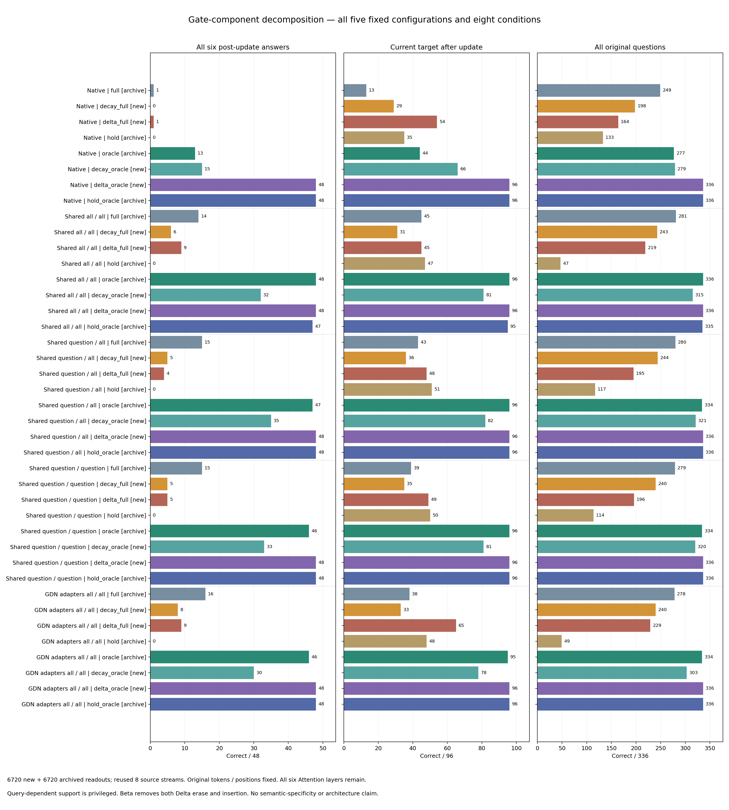

# 衰减与Delta修正的固定输入分解：完整结果

完整6720次新读出已完成并独立审计；另验证前轮6720次历史参考，统一表共13440项。复用8条事件流、48相关案例、336物理问题；五个固定配置全部保留，无新训练、模型、环境或任务案例。主运行约27.14分钟。

在Oracle读取下，**仅关闭非支持记录的Delta修正，五个配置均达48/48、336/336**；无需同时关闭衰减。仅关闭衰减的联合结果为15、32、35、33、30/48。这个分解缩小了前轮干预的解释范围，尚不证明自然记忆损伤或可部署语义控制。

## 全部40个配置与条件

联合分数要求每案例更新后两个变体的当前、历史和无关事实六项全对；三个深度各16例。角色分数分母各96，全题分母336。新测量与历史参考分别标记。

| 配置 | 条件 | 来源 | 联合 /48 | 当前 /96 | 历史 /96 | 无关 /96 | 全题 /336 | 深度1/2/3（各16） |
| --- | --- | --- | ---: | ---: | ---: | ---: | ---: | --- |
| native | full | 历史参考 | 1 | 13 | 96 | 92 | 249 | 1/0/0 |
| native | decay_full | 新测量 | 0 | 29 | 77 | 54 | 198 | 0/0/0 |
| native | delta_full | 新测量 | 1 | 54 | 29 | 54 | 164 | 1/0/0 |
| native | hold | 历史参考 | 0 | 35 | 48 | 29 | 133 | 0/0/0 |
| native | oracle | 历史参考 | 13 | 44 | 96 | 89 | 277 | 6/4/3 |
| native | decay_oracle | 新测量 | 15 | 66 | 87 | 85 | 279 | 8/4/3 |
| native | delta_oracle | 新测量 | 48 | 96 | 96 | 96 | 336 | 16/16/16 |
| native | hold_oracle | 历史参考 | 48 | 96 | 96 | 96 | 336 | 16/16/16 |
| shared | full | 历史参考 | 14 | 45 | 92 | 96 | 281 | 12/2/0 |
| shared | decay_full | 新测量 | 6 | 31 | 85 | 86 | 243 | 4/1/1 |
| shared | delta_full | 新测量 | 9 | 45 | 60 | 78 | 219 | 7/2/0 |
| shared | hold | 历史参考 | 0 | 47 | 0 | 0 | 47 | 0/0/0 |
| shared | oracle | 历史参考 | 48 | 96 | 96 | 96 | 336 | 16/16/16 |
| shared | decay_oracle | 新测量 | 32 | 81 | 91 | 96 | 315 | 11/11/10 |
| shared | delta_oracle | 新测量 | 48 | 96 | 96 | 96 | 336 | 16/16/16 |
| shared | hold_oracle | 历史参考 | 47 | 95 | 96 | 96 | 335 | 15/16/16 |
| shared_question_trained_all | full | 历史参考 | 15 | 43 | 93 | 96 | 280 | 13/1/1 |
| shared_question_trained_all | decay_full | 新测量 | 5 | 36 | 83 | 83 | 244 | 5/0/0 |
| shared_question_trained_all | delta_full | 新测量 | 4 | 48 | 33 | 83 | 195 | 3/1/0 |
| shared_question_trained_all | hold | 历史参考 | 0 | 51 | 48 | 7 | 117 | 0/0/0 |
| shared_question_trained_all | oracle | 历史参考 | 47 | 96 | 96 | 95 | 334 | 16/15/16 |
| shared_question_trained_all | decay_oracle | 新测量 | 35 | 82 | 95 | 96 | 321 | 10/12/13 |
| shared_question_trained_all | delta_oracle | 新测量 | 48 | 96 | 96 | 96 | 336 | 16/16/16 |
| shared_question_trained_all | hold_oracle | 历史参考 | 48 | 96 | 96 | 96 | 336 | 16/16/16 |
| shared_question_trained_question | full | 历史参考 | 15 | 39 | 96 | 96 | 279 | 15/0/0 |
| shared_question_trained_question | decay_full | 新测量 | 5 | 35 | 84 | 79 | 240 | 4/0/1 |
| shared_question_trained_question | delta_full | 新测量 | 5 | 49 | 32 | 84 | 196 | 4/1/0 |
| shared_question_trained_question | hold | 历史参考 | 0 | 50 | 48 | 6 | 114 | 0/0/0 |
| shared_question_trained_question | oracle | 历史参考 | 46 | 96 | 96 | 94 | 334 | 16/15/15 |
| shared_question_trained_question | decay_oracle | 新测量 | 33 | 81 | 95 | 96 | 320 | 10/12/11 |
| shared_question_trained_question | delta_oracle | 新测量 | 48 | 96 | 96 | 96 | 336 | 16/16/16 |
| shared_question_trained_question | hold_oracle | 历史参考 | 48 | 96 | 96 | 96 | 336 | 16/16/16 |
| gdn_all_tokens | full | 历史参考 | 16 | 38 | 96 | 96 | 278 | 15/0/1 |
| gdn_all_tokens | decay_full | 新测量 | 8 | 33 | 84 | 81 | 240 | 5/2/1 |
| gdn_all_tokens | delta_full | 新测量 | 9 | 65 | 47 | 80 | 229 | 7/2/0 |
| gdn_all_tokens | hold | 历史参考 | 0 | 48 | 0 | 0 | 49 | 0/0/0 |
| gdn_all_tokens | oracle | 历史参考 | 46 | 95 | 96 | 95 | 334 | 16/15/15 |
| gdn_all_tokens | decay_oracle | 新测量 | 30 | 78 | 84 | 96 | 303 | 10/10/10 |
| gdn_all_tokens | delta_oracle | 新测量 | 48 | 96 | 96 | 96 | 336 | 16/16/16 |
| gdn_all_tokens | hold_oracle | 历史参考 | 48 | 96 | 96 | 96 | 336 | 16/16/16 |

`full/oracle`：原生门控；`decay_*`：仅令log-decay g=0，保留beta；`delta_*`：仅令beta=0，保留原生log-decay；`hold/hold_oracle`：两门均阻断。`*_oracle`及`oracle`仅限制问题/回答阶段的历史证据读取。所有条件的原始Token、位置、边界和评分相同。

## 本轮判断

Native仅Oracle读取为13/48，加上抑制Delta修正为48/48，当前答案修复52项、退化0项；加上仅抑制衰减为15/48，当前答案修复32项、退化10项，历史和无关事实也有损失。因而当前Oracle上限不需要把衰减一并关掉。

原Shared/all仅Oracle读取已达48/48，关闭Delta保持48/48，关闭衰减降为32/48，两门均关为47/48。其余三个配置仅Oracle为47、46、46/48，关闭Delta后均为48/48。不能把这些结果概括为所有模型都必须改变写入。

完整读取下，关闭Delta的联合分数为1、9、4、5、9/48，均不超过各自原始条件；历史和无关事实明显受损。Native当前答案虽从13/96升到54/96，历史却从96/96降到29/96。只看当前目标的净收益会掩盖这种损害。

关闭Delta和两门均关闭的准确率相同，也不代表状态或概率分布相同。后者相对前者的当前答案平均NLL差在五配置中均为正，分别见下表；均为复用相关样本上的描述性比较。

| 配置 | L(两门+Oracle) − L(Delta+Oracle)，当前绑定均值 |
| --- | ---: |
| native | 0.145564235 |
| shared | 0.055838050 |
| shared_question_trained_all | 0.050294089 |
| shared_question_trained_question | 0.055828288 |
| gdn_all_tokens | 0.095555324 |

## 全部配对修复与退化

| 配置 | 候选 − 参考 | 修复 | 退化 |
| --- | --- | ---: | ---: |
| native | decay_full − full | 24 | 8 |
| native | delta_full − full | 43 | 2 |
| native | decay_oracle − oracle | 32 | 10 |
| native | delta_oracle − oracle | 52 | 0 |
| native | hold − decay_full | 12 | 6 |
| native | hold − delta_full | 1 | 20 |
| native | hold_oracle − decay_oracle | 30 | 0 |
| native | hold_oracle − delta_oracle | 0 | 0 |
| native | decay_oracle − decay_full | 37 | 0 |
| native | delta_oracle − delta_full | 42 | 0 |
| shared | decay_full − full | 15 | 29 |
| shared | delta_full − full | 17 | 17 |
| shared | decay_oracle − oracle | 0 | 15 |
| shared | delta_oracle − oracle | 0 | 0 |
| shared | hold − decay_full | 25 | 9 |
| shared | hold − delta_full | 14 | 12 |
| shared | hold_oracle − decay_oracle | 15 | 1 |
| shared | hold_oracle − delta_oracle | 0 | 1 |
| shared | decay_oracle − decay_full | 52 | 2 |
| shared | delta_oracle − delta_full | 51 | 0 |
| shared_question_trained_all | decay_full − full | 18 | 25 |
| shared_question_trained_all | delta_full − full | 19 | 14 |
| shared_question_trained_all | decay_oracle − oracle | 0 | 14 |
| shared_question_trained_all | delta_oracle − oracle | 0 | 0 |
| shared_question_trained_all | hold − decay_full | 27 | 12 |
| shared_question_trained_all | hold − delta_full | 17 | 14 |
| shared_question_trained_all | hold_oracle − decay_oracle | 14 | 0 |
| shared_question_trained_all | hold_oracle − delta_oracle | 0 | 0 |
| shared_question_trained_all | decay_oracle − decay_full | 48 | 2 |
| shared_question_trained_all | delta_oracle − delta_full | 48 | 0 |
| shared_question_trained_question | decay_full − full | 20 | 24 |
| shared_question_trained_question | delta_full − full | 23 | 13 |
| shared_question_trained_question | decay_oracle − oracle | 0 | 15 |
| shared_question_trained_question | delta_oracle − oracle | 0 | 0 |
| shared_question_trained_question | hold − decay_full | 25 | 10 |
| shared_question_trained_question | hold − delta_full | 17 | 16 |
| shared_question_trained_question | hold_oracle − decay_oracle | 15 | 0 |
| shared_question_trained_question | hold_oracle − delta_oracle | 0 | 0 |
| shared_question_trained_question | decay_oracle − decay_full | 47 | 1 |
| shared_question_trained_question | delta_oracle − delta_full | 47 | 0 |
| gdn_all_tokens | decay_full − full | 20 | 25 |
| gdn_all_tokens | delta_full − full | 33 | 6 |
| gdn_all_tokens | decay_oracle − oracle | 1 | 18 |
| gdn_all_tokens | delta_oracle − oracle | 1 | 0 |
| gdn_all_tokens | hold − decay_full | 24 | 9 |
| gdn_all_tokens | hold − delta_full | 3 | 20 |
| gdn_all_tokens | hold_oracle − decay_oracle | 18 | 0 |
| gdn_all_tokens | hold_oracle − delta_oracle | 0 | 0 |
| gdn_all_tokens | decay_oracle − decay_full | 46 | 1 |
| gdn_all_tokens | delta_oracle − delta_full | 31 | 0 |

## 描述性损失交互

定义F=`full`、D=`decay_full`、B=`delta_full`、H=`hold`，下标O表示对应Oracle读取。五项为：`G_full=L(H)-L(D)-L(B)+L(F)`；`G_oracle=L(HO)-L(DO)-L(BO)+L(O)`；`R_decay=L(DO)-L(D)-L(O)+L(F)`；`R_delta=L(BO)-L(B)-L(O)+L(F)`；`three_way=G_oracle-G_full`。

每格为“物理问题均值 / 当前绑定均值”。不将相关观测当作独立重复，符号不直接解释成记忆冗余或互补。逐题全部数值在factorial CSV中。

| 配置 | G_full | G_oracle | R_decay | R_delta | three_way |
| --- | ---: | ---: | ---: | ---: | ---: |
| native | -0.001554316 / 0.453514501 | 0.048213289 / 0.280636581 | -0.020951712 / 0.170927226 | -0.443211654 / -0.100252769 | 0.049767605 / -0.172877920 |
| shared | -0.353045643 / -0.131704138 | -0.045903809 / -0.091663425 | -0.042972935 / 0.192297473 | -0.198357821 / 0.190388843 | 0.307141834 / 0.040040712 |
| shared_question_trained_all | -0.430360580 / -0.241887338 | -0.021350360 / -0.081948456 | -0.148518406 / -0.033788088 | -0.265448389 / 0.097374518 | 0.409010220 / 0.159938883 |
| shared_question_trained_question | -0.365594791 / -0.076983749 | -0.000092307 / -0.039976079 | -0.127399627 / 0.043899957 | -0.268186861 / 0.141268801 | 0.365502485 / 0.037007670 |
| gdn_all_tokens | -0.331265896 / 0.055251205 | -0.082928243 / -0.060709257 | 0.016437956 / 0.385676809 | -0.172545407 / 0.350519319 | 0.248337653 / -0.115960461 |

## 执行与恢复证据

- 修正参考后234项回归测试通过；原理想FP32内核校验失败保留，见下文补充登记。
- 两轮相反配置顺序各360次smoke通过独立审计，全部原始字节和控制记录相同。
- 6720次新正式读出、8640相关绑定审计通过；历史6720参考仅验证并标注来源，不计作新测量。
- 每次正式读出均验证18层真实门控；240项新条件Attention观测、240项旧端点精确重放及56项Q-only原始前缀证明通过。
- 120项独立前缀检查覆盖每项48缓存字段、元数据及logits，并核对12项历史KV与完整主运行控制读出。
- 188份运行源码与额外1份内核参考补充登记固定；前轮已完成的180份源码不变，模型与适配器冻结、无梯度。
- CSV逐字段与浮点往返验证覆盖13440、4800、1680行；主表明确6720新/6720历史来源。图像3240×3600已检查全部40行、数值、标记及页脚，无裁切。

主运行manifest SHA256：`c14536d6bd92565fa845f3113a21ac49f3f56c95a4e0efb069a56c5b913361e6`。

主审计SHA256：`d69fdde414fd0fb482551dadaa32d57dd1ecb7f4571e5f1e37cf93e884a0035a`。

完整原始读出、数据与运行快照随本轮Release增量备份；权重、环境及编译缓存不重复上传。恢复依赖和命令见[恢复说明](restore.md)。

## 首次校验失败与修正边界

首次smoke在任何任务推理前停止：原生chunk的Delta更新不满足理想FP32插值的原容限。该失败版本188份源码、manifest和日志完整保留。无任务的十项数值探测确认，原生chunk会对状态读出和Delta残差进行BF16舍入；按安装源码的显式舍入参考，十项均通过原容限，未放宽atol/rtol。chunk相对理想式最大误差约0.011703，原理想式检查仍标记失败。

[补充登记](../../../configs/gate_component_kernel_reference_addendum.json)在任何任务推理前记录，仅修正合成内核校验参考；门控包装、任务输入、评分、模型和科学门槛不改变，每项仍报告理想式偏差。失败原始版本及数值张量保存在快照中，原始说明见[推理前记录](pre-inference-README.md)，判断规则见[解释规则](interpretation-guide.md)。

## 解释边界与下一步

beta=0同时停止沿Key方向的擦除和插入，仍不能拆分这两项。卷积、GDN读取、残差、MLP和六层Attention继续执行，改变门控也会改变后续隐藏表示与KV；GDN-only只是适配器位置。不能将结果称为纯递归记忆读出或自然状态损坏的唯一定位。

掩码使用未来问题的真实支持记录，是后见Oracle，尚非可部署控制器。固定Token/位置排除了本轮干预间的长度变化，但没有排除减少更新次数或位置安排的影响。只有8条复用事件流，48变体、336问题和432绑定存在依赖。

同一案例的不同问题可以使用不同的写入掩码，形成不同前缀状态。联合48/48不表示一个可复用的、与问题无关的记忆状态同时保住六项答案；这也是下一步不能直接训练在线语义控制器的原因。

下一步先登记等更新预算的随机/位置掩码对照，判断支持相关的选择是否超出机械减少更新的效果。若无该证据，不追加共享语义控制训练或扩模。旧架构与时序科学门槛全部保持失败，本轮不设新成功阈值。

