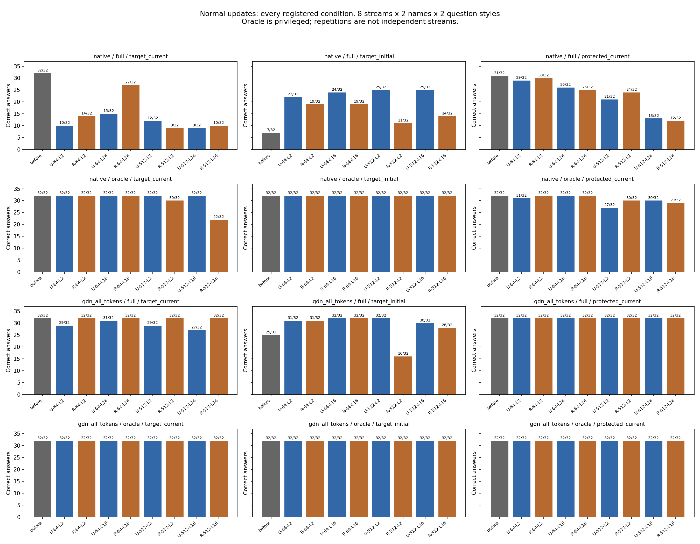

# 正常更新中的无关事实保持：预登记诊断

**本轮已完成：3,456 次读出通过独立审计，完整表格、图与全部错误归类已保留。** GDN 适配器 Full 为 821/864，保护账户 288/288，相关更新的新值 128/128；43 个错误中，40 个输出了同一账户其他版本的数值，3 个输出了其他账户的前缀数值。GDN Oracle 为 864/864。这是输出归类，不能据此断言内部实际读取了哪条记录，或判定递归状态已不可恢复地遗忘。详细结果与限制见下文。

上一轮单层 Query 定位已[完整发布](https://github.com/HUSRCF/HML-Hybrid-Memory-Lab/releases/tag/query-layer-localization-2026-11-15)。正常 GDN 强基线在原八条短流上为 191/192；人工恢复旧状态后的 Query 修复不足以说明正常更新存在结构性缺陷。本轮先检查自然条件下是否有值得修复的问题。

协议在新代码、数据与推理之前登记于 `configs/natural_update_load_plan.json`，SHA-256 为 `c0f32de5f7fc43b587300e82554e8609cfcf9a74da963659d9e1ea049b463903`。模型、环境、检查点、BF16 原生运算及适配器 FP64 累积后舍入 FP32 的诊断路径均沿用前轮；没有新增训练。

每条流的共同前缀包含 18 个账户的初始 SET 与目标账户的一次覆盖。尾部比较 2/16 个活跃账户及 64/512 条更新；两种负载共享数值序列并在完整循环中均匀更新账户。相关对照只把最后一条记录的对象换成目标账户。账户均已在共同前缀出现；第二种命名对所有账户作双射重命名。问题涵盖目标当前值、目标初始值和保护账户当前值，各用两种问法。

先用解释器与本地 Tokenizer 检查全部分词边界、每条记录 14 Token、账户命名和各负载/相关性条件的位置匹配；历史长度为 351、1,247、7,519 Token。先构造同一流的全部缓存，随后才读任何问题和答案。Full 与带真实支持标注的 Oracle 分开测量；Oracle 是特权对照。两种模型始终保留全部 Attention 层。

完整设计为 8 条新基础流 × 2 种命名 × 9 个前后条件 × 3 个问题角色 × 2 种问法 × 2 个模型 × 2 种 Reader，共 3,456 次读出、36 个汇总条件。保留初始就答错的问题。只有八条独立基础流，命名和问法不能视为额外独立样本。

两个相反模型执行顺序的运行检查各覆盖第一条流、原命名和原问法的全部 9 个条件，共 108 次读出，包含最长尾部。独立审计需核对全部原始行、48 个真实缓存字段、历史 KV、参数与钩子恢复及 96 次原端点重放；两个顺序必须逐项完全相同，主实验才启动。没有准确率筛选门槛。原先 234 个源文件保留不变，加六个新文件后封存 240 个文件。

负载变化仍会改变账户出现频率与文本；长度匹配不能把它变成纯容量实验。Full 的错误也可能来自 Attention 或问题理解，不能直接认定为 GDN 干扰。Oracle 成功只说明特权条件下可读。若正常强基线仍完成任务，应保留这一结果，不能据此宣称联合架构有必要；全部旧失败判据保持原判。

数据、运行与日志位于 `/media/990Pro/Code/SAS/{datasets,runs,logs,artifacts}/memory_update` 对应 `natural-load` 路径。`scripts/run_natural_load_pipeline.sh` 串行执行两个检查、独立审计、精确比较、主实验及最终审计；任一步失败即停止，保留失败文件，禁止静默缩短输入或切换分块计算。

封存前全套 308 项测试通过（210.648 秒）；独立重建确认 864 个问题、240 个源文件及全部分词控制，无模型构造、权重加载或 GPU 初始化。数据包 manifest SHA-256 为 `e229aa8487cd30d8c121dd14df9a6f48bb91bda73b1ade83d77be0f25bca2c9d`。封存回执和检查日志保存在本目录；封存时尚未产生模型科学结果。

封存提交 `bce57a5` 已推送后，正向模型顺序检查于 UTC `2026-11-15T09:21:20.145261+00:00` 启动。原生模型已完成其 54 次读出，当时现有 GDN 适配器继续执行；该条仅为启动时执行进度，完整结果见下文。最大 7,519 Token 路径已在原生模型运行，无需改变预登记计算路径。

两个模型顺序的检查各完成 108 次读出并通过独立审计；全部两份原始文件及每个模型的缓存、证明、端点、参数与钩子状态精确一致。检查结果未用于筛选准确率。完整 3,456 次主读出于 UTC `2026-11-15T09:25:42.776844+00:00` 启动；当时尚未完成或分析本轮科学结果。回执、审计源码副本与日志已一并备份。

## 完整结果

以下每个三元组依次为 **目标当前值／目标初始值／保护账户当前值**，每项分母均为 32。每个汇总条件共有 96 个回答；同一基础流的重命名和问法不能算作独立流。`load` 是尾部活跃账户数，`64/512` 是尾部记录数。图中 `U/R/L` 对应无关／相关／活跃账户数。

| 条件 | Native Full | Native Oracle | GDN Full | GDN Oracle |
|---|---|---|---|---|
| before | 32／7／31 | 32／32／32 | 32／25／32 | 32／32／32 |
| unrelated-64-load2 | 10／22／29 | 32／32／31 | 29／31／32 | 32／32／32 |
| related-64-load2 | 14／19／30 | 32／32／32 | 32／31／32 | 32／32／32 |
| unrelated-64-load16 | 15／24／26 | 32／32／32 | 31／32／32 | 32／32／32 |
| related-64-load16 | 27／19／25 | 32／32／32 | 32／32／32 | 32／32／32 |
| unrelated-512-load2 | 12／25／21 | 32／32／27 | 29／32／32 | 32／32／32 |
| related-512-load2 | 9／11／24 | 30／32／30 | 32／16／32 | 32／32／32 |
| unrelated-512-load16 | 9／25／13 | 32／32／30 | 27／30／32 | 32／32／32 |
| related-512-load16 | 10／14／12 | 22／32／29 | 32／28／32 | 32／32／32 |

总计：Native Full 515/864，Native Oracle 839/864；既有 GDN 适配器 Full 821/864，Oracle 864/864。两者均冻结，没有本轮训练。原生模型与适配器模型能力不同，差异不是本轮新架构的增益。

## 可以得到什么，不能得到什么

GDN 的无关尾部确实会损害部分目标当前值回答：共同前缀为 32/32，四个无关条件分别为 29、31、29、27/32，对应 3、1、3、5 次原正确回答退化，没有反向增益。这 12 次错误全部输出了目标账户的初始值。它们来自包含两次目标赋值的情形；保护账户从未被改写，在全部条件仍为 288/288。因此，不能把观察概括为所有独立事实都会被更新破坏。

版本问题比单调容量问题更突出。GDN 的初始值查询在尾部之前已经有 7/32 错误；Native 则有 25/32。加入无关尾部后，初始值准确率多数条件反而上升。相关 512 条、load2 条件下，GDN 初始值从 25 降至 16/32，配对为 2 次增益、11 次退化；这 16 次错误全部输出了最新目标值。与此同时，该条件的当前值仍是 32/32。把 load2 换成 load16，初始值变为 28/32，配对 12 次增益、0 次退化；这与“活跃对象越多就越差”的简单假设相反。

对全部 3,456 个生成回答做了事后精确数值归类，包含正确回答。每条流内记录值唯一，因此可判定一个输出数值是否等于某条记录，但不能证明模型的内部读取来源。GDN Full 43 个错误中，同账户其他版本 40 个、其他账户前缀值 3 个。Native Full 为同账户其他版本 129、其他账户记录值 213、未记录整数 7；Native Oracle 为未记录整数 16、其他账户记录值 9。没有只报告容易解释的错误子集。

问法与命名也有影响。GDN Full 的 432 对原命名→重命名比较为 3 次增益、16 次退化；432 对原问法→实体前置问法为 11 次增益、6 次退化。基础流只有八条，不能把这些配对当成大样本统计证据，或把错误归因全部交给更新动力学。

GDN Oracle 恢复了全部 43 个 Full 错误且没有退化，但它使用真实支持记录标签。它说明在这种特权访问条件下可读，不证明递归矩阵本身保留了全部信息，也不说明普通模型知道该读哪一版，更不证明只需改 GDN 或必须联合改整个四层组。Oracle 访问会改变后续计算，不能当作只移除一个无关因素的纯因果控制。

这里“正常更新”指没有人工恢复状态或抑制门控的原模型运行；输入仍是可执行的合成 SET 账本，不是自然文本分布。历史最长 7,519 Token，不代表 100K 行为。没有新显著性判据、规模扩展触发条件或架构有效性结论，先前三个失败判据仍全部为 false。

## 验证与恢复

全套 308 项测试、独立 Tokenizer/解释器重建、两个相反模型顺序的检查、每次运行的 96 次原端点重放、10 项原生数值核对、32 个前缀及 256 个尾部缓存检查均通过。主实验与执行检查重合的 108 次读出也逐项精确一致；相应 2 个前缀与 16 个尾部缓存的 48 字段、logits、布局和尾部证明相同，只有预登记问题数导致的检查次数不同。这个附加只读核对在事后执行，没有新推理或容差修改。

已导出并读回核对：3,456 行原始结果、20,736 行 Reader 概率、36 个汇总条件、432 个分层条件、192 个配对汇总、6,144 个逐流配对和 576 个逐流条件；另外保留 6,912 个跨模型／Reader／命名／问法配对。全部图表已目视检查，材料副本逐文件校验。原始日志、独立审计、源码副本及源文件封存回执均在本目录；模型权重与旧训练检查点沿用前轮 Release 链。

## 下一步候选，尚未登记或运行

先在全部相同历史缓存上，检查等长的“初始／当前”与“第一次／最后一次赋值”问法能否改变版本错误，保留所有原始问题，不只挑选 43 个失败回答。问题长度需要 Tokenizer 控制；若不能匹配，应记录失败并在推理前另行登记。该候选只测试语义指代和读取，不产生新的更新模块。

如果简单问法控制就消除多数错误，就应承认现有证据还不足以支持复杂架构；若错误仍存在，再用受控状态／证据访问实验定位。不能因为输出另一个版本的值，就跳过这一步宣称发现了“递归记忆被覆盖”。本轮先完成完整备份与发布，再确定下一份协议。
