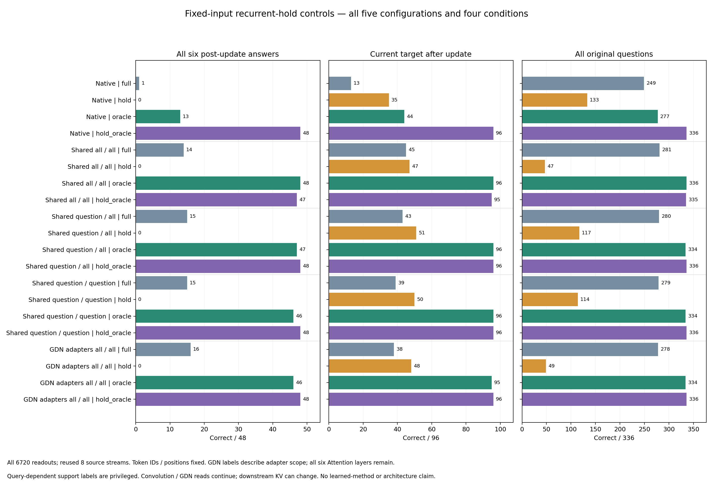

# 固定原始输入的递归更新阻断诊断

完整6720次读出已完成并独立审计。保持原始Token、位置和问题边界，交叉无关记录递归更新阻断与查询阶段Oracle读取；全部五个配置、三种深度和逐题退化均保留。

| 配置 | 条件 | 联合 /48 | 当前 /96 | 历史 /96 | 无关 /96 | 全题 /336 | 深度1/2/3（各16） |
| --- | --- | ---: | ---: | ---: | ---: | ---: | --- |
| native | full | 1 | 13 | 96 | 92 | 249 | 1/0/0 |
| native | hold | 0 | 35 | 48 | 29 | 133 | 0/0/0 |
| native | oracle | 13 | 44 | 96 | 89 | 277 | 6/4/3 |
| native | hold_oracle | 48 | 96 | 96 | 96 | 336 | 16/16/16 |
| shared | full | 14 | 45 | 92 | 96 | 281 | 12/2/0 |
| shared | hold | 0 | 47 | 0 | 0 | 47 | 0/0/0 |
| shared | oracle | 48 | 96 | 96 | 96 | 336 | 16/16/16 |
| shared | hold_oracle | 47 | 95 | 96 | 96 | 335 | 15/16/16 |
| shared_question_trained_all | full | 15 | 43 | 93 | 96 | 280 | 13/1/1 |
| shared_question_trained_all | hold | 0 | 51 | 48 | 7 | 117 | 0/0/0 |
| shared_question_trained_all | oracle | 47 | 96 | 96 | 95 | 334 | 16/15/16 |
| shared_question_trained_all | hold_oracle | 48 | 96 | 96 | 96 | 336 | 16/16/16 |
| shared_question_trained_question | full | 15 | 39 | 96 | 96 | 279 | 15/0/0 |
| shared_question_trained_question | hold | 0 | 50 | 48 | 6 | 114 | 0/0/0 |
| shared_question_trained_question | oracle | 46 | 96 | 96 | 94 | 334 | 16/15/15 |
| shared_question_trained_question | hold_oracle | 48 | 96 | 96 | 96 | 336 | 16/16/16 |
| gdn_all_tokens | full | 16 | 38 | 96 | 96 | 278 | 15/0/1 |
| gdn_all_tokens | hold | 0 | 48 | 0 | 0 | 49 | 0/0/0 |
| gdn_all_tokens | oracle | 46 | 95 | 96 | 95 | 334 | 16/15/15 |
| gdn_all_tokens | hold_oracle | 48 | 96 | 96 | 96 | 336 | 16/16/16 |

`full`：原始更新/完整读取；`hold`：阻断非支持记录更新/完整读取；`oracle`：原始更新/支持读取；`hold_oracle`：阻断更新/支持读取。

## 本轮观察

Native在原始条件为1/48，单独阻断无关记录更新为0/48，单独限制问题阶段读取为13/48，两者同时为48/48、336/336物理问题全对，三个深度各16/16。这里保持了原始输入和位置。

单独阻断更新在五个配置中均为0/48；历史或无关事实读出显著下降。仅看当前目标答案的净增益会掩盖这些损害。原Shared仅限制读取已达48/48，叠加阻断后为47/48，并有一次当前答案退化；其余三个适配配置从47、46、46/48变为48/48。

这表明本轮特权干预的效果依赖读写路径的组合。它不证明已有递归状态自然受损，不证明共享语义控制器有普遍收益，也不支持据此追加训练或扩大模型。下一步先核对等预算及衰减/写入分解控制的可行性。

## 配对的当前答案修复与退化

| 配置 | 对照 | 修复 | 退化 |
| --- | --- | ---: | ---: |
| native | hold − full | 29 | 7 |
| native | hold_oracle − oracle | 52 | 0 |
| native | oracle − full | 32 | 1 |
| native | hold_oracle − hold | 61 | 0 |
| shared | hold − full | 21 | 19 |
| shared | hold_oracle − oracle | 0 | 1 |
| shared | oracle − full | 51 | 0 |
| shared | hold_oracle − hold | 48 | 0 |
| shared_question_trained_all | hold − full | 28 | 20 |
| shared_question_trained_all | hold_oracle − oracle | 0 | 0 |
| shared_question_trained_all | oracle − full | 53 | 0 |
| shared_question_trained_all | hold_oracle − hold | 45 | 0 |
| shared_question_trained_question | hold − full | 30 | 19 |
| shared_question_trained_question | hold_oracle − oracle | 0 | 0 |
| shared_question_trained_question | oracle − full | 57 | 0 |
| shared_question_trained_question | hold_oracle − hold | 46 | 0 |
| gdn_all_tokens | hold − full | 30 | 20 |
| gdn_all_tokens | hold_oracle − oracle | 1 | 0 |
| gdn_all_tokens | oracle − full | 57 | 0 |
| gdn_all_tokens | hold_oracle − hold | 48 | 0 |

## 损失交互（描述性）

公式为`L(hold_oracle) - L(hold) - L(oracle) + L(full)`。物理问题与当前目标绑定分别平均；这些相关观测不作为独立统计重复，符号不直接解释为记忆冗余或互补。

| 配置 | 物理问题均值 /336 | 当前绑定均值 /96 |
| --- | ---: | ---: |
| native | -0.414395761 | -0.102203463 |
| shared | 0.065811078 | 0.422727028 |
| shared_question_trained_all | -0.004956574 | 0.223525312 |
| shared_question_trained_question | -0.030084004 | 0.222176428 |
| gdn_all_tokens | 0.092230202 | 0.620235666 |

## 执行证据

- 229项测试通过；两轮各360次smoke的原始字节及控制记录完全相同。
- 全部6720次正式读出及8640个绑定通过独立审计，3360次原始full/oracle五字段重放精确一致。
- 60次缓存步进中，18层递归状态全部精确保留，卷积与六层KV缓存继续推进。
- 独立120项前缀检查覆盖每项48个缓存字段、完整元数据和logits，以及12项历史KV切片。
- 120项no-op包装控制、240项实际Attention概率控制及56项原始Q-only前缀检查通过。
- 180份测量源码保持不变，主干与适配器权重冻结、无梯度，运行和清理后记录完整。
- 主运行manifest SHA256：`290d0cd3d8a4dc63340bf0cda5be695238ab581c641b0703f0feaa4bb8632fd3`。
- 主审计SHA256：`7be39244115b2f489fabcb474d7583afc4bdec862ad8336adef905ecd3f9e680`。

CSV逐字段核验覆盖6720行原始表、1920行配对表及1680行交互表；图像2880×1980已检查标签、数值和页脚。恢复路径见[快照说明](restore.md)。

## 解释边界

阻断18层GDN在原始非支持记录位置的衰减与写入；短卷积、GDN读出、MLP、残差及全部六层Attention继续执行。GDN-only仅指适配器路径，不代表移除Attention。

支持标签来自后续问题的真实依赖，具有后见信息；结果不是可部署的在线更新方法。改变递归更新也会影响下游隐藏表示和KV，不能唯一解释成自然状态损伤或提出新架构的充分理由。

来源只有8条事件流；48个变体、432个绑定存在相关性。全部旧架构/时序失败门槛保持失败；本轮无新成功阈值、不训练、不扩模。两项干预的损失交互仅作描述。

全部源码、原始读出、预登记、反向顺序smoke、状态/门控/Attention/缓存证明及导出表随本轮快照备份。预登记内容见[原始说明](pre-inference-README.md)。

## 完整快照已发布

[Release及三个附件](https://github.com/HUSRCF/HML-Hybrid-Memory-Lab/releases/tag/oracle-write-hold-factorial-2026-11-15)。归档含1775个载荷文件、1776个成员，12781070字节；SHA256为`8c948947c3e9d2b209183acf94509117e417e3649e591f5e748232baed5e562d`。

快照提交为`2593c263d408a15b8137ce300272827b173ccab8`，其中226份提交文件按归档逐字节核对；三个附件实际下载核验通过。最终回执是[publication-02](oracle-write-hold-publication-20261115-02.json)。

首次上传后，草稿按标签查询返回404；改为按Release及附件ID下载、核验和发布。保留[首次记录](oracle-write-hold-publication-20261115-01.json)及两份对应源代码，修正限于发布工具，180份测量源码未变。快照保持发布前版本，最终操作回执与工具修正另存于主分支。
