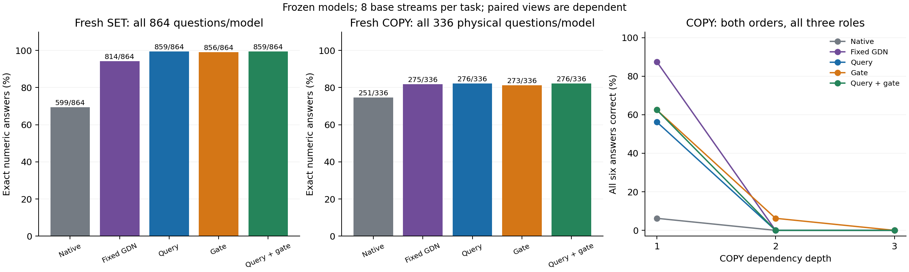

# Frozen readout controls: complete new-stream confirmation

All 6,000 registered physical answers and 6,480 logical bindings completed and passed independent audit. No prospective question was used for training, checkpoint selection, cohort replacement or early stopping. All three controls use the final step-432 checkpoints fixed before constructing either new cohort.

| Frozen model | SET /864 | COPY physical /336 | COPY six-answer units /48 |
| --- | ---: | ---: | ---: |
| native | 599 | 251 | 1 |
| fixed_gdn | 814 | 275 | 14 |
| query | 859 | 276 | 9 |
| gate | 856 | 273 | 11 |
| query_gate | 859 | 276 | 10 |

All three readout controls improve SET net accuracy on every one of the eight base streams. Query and joint each repair 47 baseline errors while adding two protected-account errors; gate repairs 43 while adding one other error and preserves all 288 protected answers. COPY aggregate accuracy changes little, but its six-answer joint metric declines from 14/48 to 9/48, 11/48 and 10/48. Query has zero joint repairs and five regressions; gate has one repair and four regressions; joint has zero repairs and four regressions. Thus improved SET version reading does not preserve all prior successes or solve relational transfer. Both Query and output-gate training help SET, so these results do not uniquely identify a Query-address mechanism.

COPY physical questions are deduplicated: its 432 logical role/order/depth/style bindings map to 336 actual answers per model. Each COPY six-answer unit requires both control/treatment event orders and all current/initial/protected questions correct. All 48 units and the before-update questions remain in the raw exports; the joint metric excludes the before variant.

## Every repair and regression against the fixed GDN baseline

| Readout control | Task | Repairs | New errors | Independent base-stream net gains / losses / ties |
| --- | --- | ---: | ---: | --- |
| query | set | 47 | 2 | 8 / 0 / 0 |
| query | copy | 7 | 6 | 3 / 4 / 1 |
| gate | set | 43 | 1 | 8 / 0 / 0 |
| gate | copy | 2 | 4 | 1 / 2 / 5 |
| query_gate | set | 47 | 2 | 8 / 0 / 0 |
| query_gate | copy | 6 | 5 | 2 / 3 / 3 |

These repair/regression counts use physical answers. The complete [physical pairs](exports/all-model-pairs-physical.csv) and [logical pairs](exports/all-model-pairs-logical.csv) retain all ten model comparisons, not only comparisons to fixed GDN.

## SET role and version errors

| Model | Current /288 | Initial /288 | Protected /288 | Wrong answer matches another seen value of requested account |
| --- | ---: | ---: | ---: | ---: |
| native | 147 | 230 | 222 | 77 |
| fixed_gdn | 259 | 267 | 288 | 50 |
| query | 288 | 285 | 286 | 3 |
| gate | 283 | 285 | 288 | 8 |
| query_gate | 288 | 285 | 286 | 2 |

The final column describes an output-value match, not proof of attending to a particular record or losing a stored version. All malformed, other-entity, ambiguous and unrecorded-value outputs remain in [the complete answers](exports/physical-readouts.csv). COPY can propagate identical values across accounts; matching entities are explicitly retained rather than treating a numeric match as unique attribution.

## COPY joint results by dependency depth

| Model | Depth 1 /16 | Depth 2 /16 | Depth 3 /16 | Protected physical /112 |
| --- | ---: | ---: | ---: | ---: |
| native | 1 | 0 | 0 | 105 |
| fixed_gdn | 14 | 0 | 0 | 112 |
| query | 9 | 0 | 0 | 112 |
| gate | 10 | 1 | 0 | 112 |
| query_gate | 10 | 0 | 0 | 112 |

## Design and interpretation limits

- Protocol `configs/readout_adapter_confirmation_plan.json` was registered at `3e44ab1` before implementation or prospective construction. The training protocol already fixed these cohort seeds. Training locks pin all saved checkpoints, optimizer/RNG states, fit logs and audits before new inputs are generated.
- Eight independent base streams per task; names, question styles, dependency depths, event orders and record loads are paired views. There is one training initialization. Counts of questions or six-answer units are not independent sample sizes. Fresh SET seeds remain within the same generator and question-template families used for adaptation; this is not evidence of out-of-domain SET generalization.
- SET seeds 88000–88007 cover both account names, all nine normal histories, two one-token-matched question wordings and all three roles. COPY seeds 89000–89007 retain depths 1/2/3, both styles, alternating 8/64 distractors and all variants/roles. The actual 208-file prior-input inventory has no seed, ID, full-prefix or full-prompt overlap; the cohort was not resampled.
- Before confirmation, 30 observed-fit replays were exactly reproduced. All 372 CPU regression tests passed before sealing 289 source files. All 282 predecessor sources remain unchanged.
- No Oracle, donor forward, recurrent rollback, gate intervention, sparse reader or further training is used. Each question forks an isolated normally built history. All 200 history records per learned readout match fixed GDN across all 48 tensor values, layouts, metadata and prefix logits; all source caches are guarded.
- Each readout adds 131,072 parameters at layer 15 on the existing frozen GDN adapter. Query-only, output-gate-only and joint controls all use matched question/answer-only training and deployment. They are simple readout baselines, not a shared four-layer semantic controller.
- Longest SET history: 7,519 tokens; longest COPY: 1,389 tokens. These results do not establish 100K-context behavior. The SET active-entity field denotes the nominal 2/16-account distractor pool; related tails additionally update the queried target.
- COPY evaluates transfer/retention of SET-only readout adaptation. SET success does not demonstrate multi-hop success, and an error cannot by itself identify a unique GDN or Attention cause.
- SET six-answer exports require two question wordings and three roles on one history. This differs from COPY two-order six-answer units and does not revise earlier registered joint-success criteria.
- All three earlier failed scientific criteria remain false in their original scope. A new architecture advantage, unique Query-address explanation, independent-controller superiority comparison and shared-block benefit remain unestablished.

## Complete artifacts

- [Independent primary audit](readout-confirmation-primary-audit-20261116-01.json) and [complete run manifest](primary-run-manifest.json.gz).
- [All 6,000 physical answers](exports/physical-readouts.csv), [6,480 logical bindings](exports/all-logical-bindings.csv), [all 1,080 role-condition cells](exports/all-role-condition-cells.csv), [all 80 base-stream rows](exports/all-base-streams.csv).
- [All six-answer units](exports/all-joint6-units.csv), [all joint model pairs](exports/all-joint6-model-pairs.csv), [all model/task contrasts](exports/all-model-task-contrasts.csv).
- [Wordings](exports/all-wording-pairs.csv), [current/initial](exports/all-current-initial-pairs.csv), [renaming](exports/all-account-renaming-pairs.csv), [tail lengths](exports/all-tail-length-pairs.csv), [nominal account pools](exports/all-active-account-pairs.csv), [update relevance](exports/all-update-relevance-pairs.csv), [before/after normal updates](exports/all-before-after-pairs.csv).
- The complete run manifest is losslessly gzipped with a byte-verification receipt; the audited native run file is unchanged. All five raw JSONL files, complete source/test/input receipts and complete logs are retained in this folder. The external archive additionally includes literal inputs, sealed sources and trained checkpoint dependencies. Native 2B pretrained weights and the existing Conda environment remain separate dependencies.

Full backup packaging/publication is the next operational step. The broader hybrid-memory research goal remains active.
