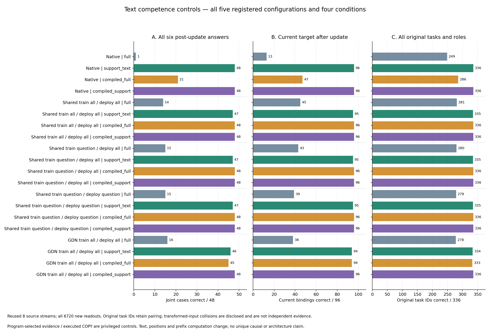

# 文本能力交叉对照：全部6720次正式结果

**6720次正式读出、独立审计与全量导出完成。** 固定五个既有配置、全部336个原物理问题和432个关联绑定，交叉比较历史范围与事件执行形式。

复用63000–63007的8个来源流、48个相关案例；没有新训练、新环境或模型选择。各条件改变文本、Token数、位置和历史状态计算，属于特权能力控制，不是冻结历史的因果定位或新架构验证。旧失败门槛保持原判。

命名范围：五个配置都使用相同的混合主干，六个Attention层始终保留。“GDN-only”指适配器只作用于GDN路径，不是移除Attention后的纯递归模型；该配置的成绩不能证明GDN状态单独包含或输出了答案。

- full：完整原事件。
- support_text：程序按当前问题反向切片后的完整支持事件。
- compiled_full：完整历史中逐步将COPY改写成该时刻实际执行值的SET。
- compiled_support：支持事件中的COPY逐步改写为SET。

编译后的每个中间步骤，所有实体的当前值与初始值均与相应原程序相同；不把问题金标附加到提示中。指令、问题表述、分词器、原始无限制答案生成与停止条件固定。

## 全部条件与输入去重

联合指标要求两种更新顺序下的当前、历史与无关值共6个答案全部正确。原任务ID仍用于配对；文本变换后重复输入不构成独立证据。full与compiled_full各336种实际输入，support_text与compiled_support各144种。

| 配置 | 条件 | 联合 /48 | 当前 /96 | 历史 /96 | 无关 /96 | 原任务 /336 | 去重输入正确 /总数 |
|---|---|---:|---:|---:|---:|---:|---:|
| Native | full | 1 | 13 | 96 | 92 | 249 | 249 / 336 |
| Native | support_text | 48 | 96 | 96 | 96 | 336 | 144 / 144 |
| Native | compiled_full | 21 | 47 | 95 | 96 | 286 | 286 / 336 |
| Native | compiled_support | 48 | 96 | 96 | 96 | 336 | 144 / 144 |
| Shared训练all/部署all | full | 14 | 45 | 92 | 96 | 281 | 281 / 336 |
| Shared训练all/部署all | support_text | 47 | 95 | 96 | 96 | 335 | 143 / 144 |
| Shared训练all/部署all | compiled_full | 48 | 96 | 96 | 96 | 336 | 336 / 336 |
| Shared训练all/部署all | compiled_support | 48 | 96 | 96 | 96 | 336 | 144 / 144 |
| Shared训练question/部署all | full | 15 | 43 | 93 | 96 | 280 | 280 / 336 |
| Shared训练question/部署all | support_text | 47 | 95 | 96 | 96 | 335 | 143 / 144 |
| Shared训练question/部署all | compiled_full | 48 | 96 | 96 | 96 | 336 | 336 / 336 |
| Shared训练question/部署all | compiled_support | 48 | 96 | 96 | 96 | 336 | 144 / 144 |
| Shared训练question/部署question | full | 15 | 39 | 96 | 96 | 279 | 279 / 336 |
| Shared训练question/部署question | support_text | 47 | 95 | 96 | 96 | 335 | 143 / 144 |
| Shared训练question/部署question | compiled_full | 48 | 96 | 96 | 96 | 336 | 336 / 336 |
| Shared训练question/部署question | compiled_support | 48 | 96 | 96 | 96 | 336 | 144 / 144 |
| GDN训练all/部署all | full | 16 | 38 | 96 | 96 | 278 | 278 / 336 |
| GDN训练all/部署all | support_text | 46 | 94 | 96 | 96 | 334 | 142 / 144 |
| GDN训练all/部署all | compiled_full | 45 | 94 | 95 | 96 | 333 | 333 / 336 |
| GDN训练all/部署all | compiled_support | 48 | 96 | 96 | 96 | 336 | 144 / 144 |

## 全部深度

| 配置 | 条件 | 深度1 /16 | 深度2 /16 | 深度3 /16 |
|---|---|---:|---:|---:|
| Native | full | 1 | 0 | 0 |
| Native | support_text | 16 | 16 | 16 |
| Native | compiled_full | 5 | 6 | 10 |
| Native | compiled_support | 16 | 16 | 16 |
| Shared训练all/部署all | full | 12 | 2 | 0 |
| Shared训练all/部署all | support_text | 16 | 16 | 15 |
| Shared训练all/部署all | compiled_full | 16 | 16 | 16 |
| Shared训练all/部署all | compiled_support | 16 | 16 | 16 |
| Shared训练question/部署all | full | 13 | 1 | 1 |
| Shared训练question/部署all | support_text | 16 | 16 | 15 |
| Shared训练question/部署all | compiled_full | 16 | 16 | 16 |
| Shared训练question/部署all | compiled_support | 16 | 16 | 16 |
| Shared训练question/部署question | full | 15 | 0 | 0 |
| Shared训练question/部署question | support_text | 16 | 16 | 15 |
| Shared训练question/部署question | compiled_full | 16 | 16 | 16 |
| Shared训练question/部署question | compiled_support | 16 | 16 | 16 |
| GDN训练all/部署all | full | 15 | 0 | 1 |
| GDN训练all/部署all | support_text | 16 | 15 | 15 |
| GDN训练all/部署all | compiled_full | 15 | 15 | 15 |
| GDN训练all/部署all | compiled_support | 16 | 16 | 16 |

## 全部配对变换效应

候选相对参照的改善与退化均保留。当前NLL差为候选减参照，负值表示金标损失降低。

| 配置 | 候选 | 参照 | 当前改善 /退化 | 联合改善 /退化 | 原任务修复 /退化 | 当前平均NLL差 |
|---|---|---|---:|---:|---:|---:|
| Native | support_text | full | 83 / 0 | 47 / 0 | 87 / 0 | -0.884934231 |
| Native | compiled_full | full | 37 / 3 | 20 / 0 | 41 / 4 | -0.615280509 |
| Native | compiled_support | support_text | 0 / 0 | 0 / 0 | 0 / 0 | -0.0757926312 |
| Native | compiled_support | compiled_full | 49 / 0 | 27 / 0 | 50 / 0 | -0.345446353 |
| Shared训练all/部署all | support_text | full | 51 / 1 | 33 / 0 | 55 / 1 | -0.790228542 |
| Shared训练all/部署all | compiled_full | full | 51 / 0 | 34 / 0 | 55 / 0 | -0.795286408 |
| Shared训练all/部署all | compiled_support | support_text | 1 / 0 | 1 / 0 | 1 / 0 | -0.0158279853 |
| Shared训练all/部署all | compiled_support | compiled_full | 0 / 0 | 0 / 0 | 0 / 0 | -0.0107701195 |
| Shared训练question/部署all | support_text | full | 53 / 1 | 32 / 0 | 56 / 1 | -0.62595958 |
| Shared训练question/部署all | compiled_full | full | 53 / 0 | 33 / 0 | 56 / 0 | -0.63725745 |
| Shared训练question/部署all | compiled_support | support_text | 1 / 0 | 1 / 0 | 1 / 0 | -0.0186369387 |
| Shared训练question/部署all | compiled_support | compiled_full | 0 / 0 | 0 / 0 | 0 / 0 | -0.00733906854 |
| Shared训练question/部署question | support_text | full | 57 / 1 | 32 / 0 | 57 / 1 | -0.729147434 |
| Shared训练question/部署question | compiled_full | full | 57 / 0 | 33 / 0 | 57 / 0 | -0.747940962 |
| Shared训练question/部署question | compiled_support | support_text | 1 / 0 | 1 / 0 | 1 / 0 | -0.0251760243 |
| Shared训练question/部署question | compiled_support | compiled_full | 0 / 0 | 0 / 0 | 0 / 0 | -0.0063824967 |
| GDN训练all/部署all | support_text | full | 56 / 0 | 30 / 0 | 56 / 0 | -0.842415943 |
| GDN训练all/部署all | compiled_full | full | 56 / 0 | 30 / 1 | 56 / 1 | -0.883786004 |
| GDN训练all/部署all | compiled_support | support_text | 2 / 0 | 2 / 0 | 2 / 0 | -0.0545277067 |
| GDN训练all/部署all | compiled_support | compiled_full | 2 / 0 | 3 / 0 | 3 / 0 | -0.0131576456 |

## 描述性的交叉NLL项

`NLL(compiled_support) - NLL(support_text) - NLL(compiled_full) + NLL(full)`逐问题计算。它描述两种文本变换在当前损失尺度上的非加性，不唯一识别检索、组合、GDN损伤或记忆互补机制。

| 配置 | 全部336原任务平均值 | 当前目标96绑定平均值 |
|---|---:|---:|
| Native | 0.192809442 | 0.539487878 |
| Shared训练all/部署all | 0.233774803 | 0.779458423 |
| Shared训练question/部署all | 0.185176622 | 0.618620512 |
| Shared训练question/部署question | 0.208252313 | 0.722764938 |
| GDN训练all/部署all | 0.236951948 | 0.829258298 |

## 本轮支持与不支持的判断

Native在保留原始COPY逻辑的support_text条件下达到48/48，三个深度均为16/16，144种实际输入全部正确；相对full的336个原任务有87个修复、0个退化。因此，不能把完整历史上的多跳失败概括为“这个模型在任何条件下都不会执行这些关系”。这是Oracle支持事件上的有条件能力证据，不代表它能自己找出这些事件。

仅将完整历史中的COPY编译为SET，Native仍只有21/48：41个原任务修复，但有4个退化，50题仍错。三个Shared配置在compiled_full中均为48/48，GDN适配器配置为45/48；compiled_support中五个配置均为48/48。完整历史范围和操作形式都值得研究，但这些文本变换不构成对某个内部机制的独立定位。

与[前轮冻结前缀的Oracle掩码](../trained-timing-evidence-access-20261115/README.md)相比，Native的13/48与本轮支持文本48/48有明显差异。前者保留完整历史计算，只限制问题阶段Attention历史列；后者改变文本、位置、递归历史计算和上下文化KV。这个比较仅作既有结果的解释背景，旧掩码读出不计入本轮6720次测量，也不能将二者之差直接解释为GDN记忆损伤。

各配置当前目标的平均交叉NLL项均为正，不能据此声称发现了记忆模块互补或冗余：损失下界、显式答案数值及文本分布变化都会影响非加性。当前结果更支持先研究完整上下文中的证据使用与表示敏感性，尚不足以直接扩大模型或追加复杂的记忆保护结构。旧三项失败门槛保持原判。

## 审计与解释限制

两组相反顺序的360次安全运行、独立审计及精确等价性在正式推理前完成。全部1680次full重放与前轮五字段精确一致；核验172份封存源码、48个独立native锚点、240次启用前native复测、192次attached-none、240次移除后复测和240组六层Attention观察。question配置核验240个条件内的完整历史前缀，原始full前缀也与既有记录匹配。权重未变，钩子已恢复。

支持事件由查询特定的程序Oracle选择，编译由解释器直接执行；成功不说明LLM能自己学习这两个过程。即使compiled条件改善，也可能来自更短位置距离、显式数值、更简单文本或输入分布改变，不能唯一归因于关系组合。变换后失败也不能证明组合能力缺失或递归记忆损伤。

所有条件、角色、来源流、深度、表述、更新量及逐问题退化均在JSON/CSV中；不把相关变体或重复输入当成独立样本。通用配对工具中的candidate_passed是继承的描述字段，不是本阶段成功门槛，不改变旧失败判定。

## 完整材料

- [独立审计](text-competence-factorial-audit-20261115-01.json)
- [全部6720条原始任务读出](text-competence-factorial-figure-20261115-01.csv)
- [全部1920条当前目标配对NLL](text-competence-factorial-figure-20261115-01.pairs.csv)
- [全部1680条逐原任务交叉NLL](text-competence-factorial-figure-20261115-01.factorial.csv)
- [全部指标、分层、重复输入与逐问题比较](text-competence-factorial-figure-20261115-01.data.json)
- [独立计数与逐条CSV核验](text-competence-factorial-figure-20261115-01.crosscheck.json)
- [PDF图表](text-competence-factorial-figure-20261115-01.pdf)
- [输入碰撞登记](input-collisions.json)
- [推理前登记与验证记录](pre-inference-notes.md)
- [独立程序解释器对已保存文本及全部别名绑定的核验](text-competence-factorial-truth-crosscheck-20261115-01.json)

完整归档与远端发布回执将在完成后另行加入。

完整测试223项通过；额外的独立解释器核验1344份文本、16176对中间状态及1728个别名绑定。2880×1980图表已目视检查，未见裁切。6720条主CSV、1920条配对CSV及1680条交叉NLL CSV均逐条对照原始答案、损失或程序绑定验证。

## 完整增量归档

归档的1717个材料文件、1718个条目均经解压字节验证；大小15,595,589字节，SHA-256 `287a3d37ac59ce569f99d1bc8bc5f1ece81b50b414e5386e6fac3224013d419f`。

包含全部20份完整原始结果、两组安全运行、1344份文本登记和输入碰撞、原始队列、172份封存源码、独立真值核验、完整CSV/指标/图表及前轮参考记录。主干权重、环境、缓存和已发布的训练检查点不重复上传。归档保留快照当时的日志与进度；最终打包和远端发布回执另存，避免自引用。

- [逐文件SHA-256清单](file_manifest.json)
- [本地逐项验证回执](local_verification.json)
- [本轮完整材料Release](https://github.com/HUSRCF/HML-Hybrid-Memory-Lab/releases/tag/text-competence-factorial-2026-11-15)
- [已有训练检查点Release](https://github.com/HUSRCF/HML-Hybrid-Memory-Lab/releases/tag/matched-shared-training-timing-2026-11-15)
