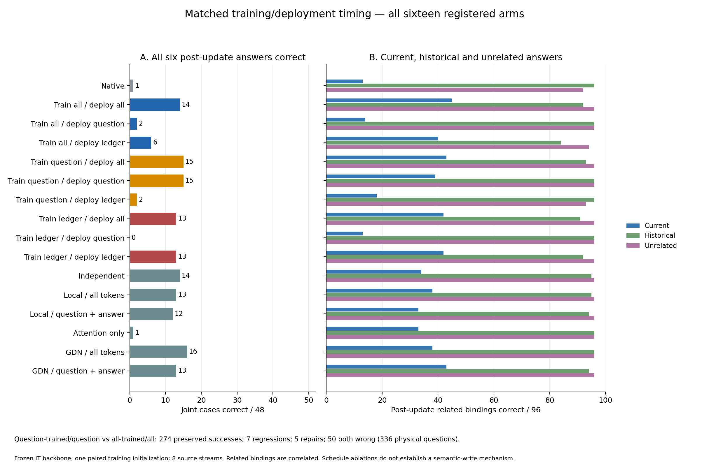

# 匹配训练与部署时机：完整新样本结果

**5376次正式读出及独立审计完成；三项预登记研究门槛全部未通过。** 匹配训练大幅缓解了只做部署消融时的损失，但没有证明显式语义作用域架构有效，也没有超过全部强基线。

Qwen3.5-2B IT 主干冻结；两组新增控制器采用相同初始化、864训练样本和各432次更新。固定63000–63007的8个新事件流，48个关联案例、336个物理问题及432个关联绑定。所有16配置均保留，不挑选问题或检查点。48个案例包含重复深度/表述变体，不是48个独立来源流。

## 完整结果

联合指标要求一次更新后的当前值、历史值、无关值在两种更新顺序下全部正确，共6个读出。角色列为更新后相关绑定计数，重复绑定不当作独立样本。question 包括提问与回答阶段，ledger 为之前的完整历史阶段。

| 配置 | 联合 /48 | 当前 /96 | 历史 /96 | 无关 /96 | 物理问题 /336 |
|---|---:|---:|---:|---:|---:|
| Native | 1 | 13 | 96 | 92 | 249 |
| Shared：训练 all / 部署 all | 14 | 45 | 92 | 96 | 281 |
| Shared：训练 all / 部署 question | 2 | 14 | 96 | 96 | 254 |
| Shared：训练 all / 部署 ledger | 6 | 40 | 84 | 94 | 266 |
| Shared：训练 question / 部署 all | 15 | 43 | 93 | 96 | 280 |
| Shared：训练 question / 部署 question | 15 | 39 | 96 | 96 | 279 |
| Shared：训练 question / 部署 ledger | 2 | 18 | 96 | 93 | 255 |
| Shared：训练 ledger / 部署 all | 13 | 42 | 91 | 96 | 277 |
| Shared：训练 ledger / 部署 question | 0 | 13 | 96 | 96 | 253 |
| Shared：训练 ledger / 部署 ledger | 13 | 42 | 92 | 96 | 278 |
| Independent | 14 | 34 | 95 | 96 | 273 |
| Local / all | 13 | 38 | 95 | 96 | 277 |
| Local / question | 12 | 33 | 94 | 96 | 271 |
| Attention-only | 1 | 33 | 96 | 96 | 273 |
| GDN / all | 16 | 38 | 96 | 96 | 278 |
| GDN / question | 13 | 43 | 94 | 96 | 281 |

## 三项预登记判断

- 匹配 question 训练与部署，相对 all 训练/question 部署：13个联合案例改善、0个变差；但改善全部在深度1，深度2和3净增益均为0。因此“每个深度均正增益”的门槛未通过。7/8个基础流有正净增益。
- 匹配 question 训练与部署，相对 Native：14个联合案例改善、0个变差；新增收益也全部在深度1，深度2和3均为0。因此该门槛同样未通过。8/8个基础流有正净增益。
- 相对原 Shared/all 的336个物理问题：274个共同正确，7个退化，5个修复，50个共同错误。严格保留全部已有正确问题的门槛未通过。

匹配 question 训练/部署为15/48，原 Shared/all 为14/48，GDN/all 为16/48。这些差异来自同一个训练初始化和同一任务族的新事件流，不是独立训练重复或新架构成功。所有旧失败门槛保持原判。

## 深度分解

| 配置 | 深度1 /16 | 深度2 /16 | 深度3 /16 |
|---|---:|---:|---:|
| Native | 1 | 0 | 0 |
| Shared：训练 all / 部署 all | 12 | 2 | 0 |
| Shared：训练 all / 部署 question | 2 | 0 | 0 |
| Shared：训练 all / 部署 ledger | 4 | 2 | 0 |
| Shared：训练 question / 部署 all | 13 | 1 | 1 |
| Shared：训练 question / 部署 question | 15 | 0 | 0 |
| Shared：训练 question / 部署 ledger | 2 | 0 | 0 |
| Shared：训练 ledger / 部署 all | 12 | 0 | 1 |
| Shared：训练 ledger / 部署 question | 0 | 0 | 0 |
| Shared：训练 ledger / 部署 ledger | 13 | 0 | 0 |
| Independent | 14 | 0 | 0 |
| Local / all | 13 | 0 | 0 |
| Local / question | 12 | 0 | 0 |
| Attention-only | 1 | 0 | 0 |
| GDN / all | 15 | 0 | 1 |
| GDN / question | 11 | 1 | 1 |

## 这轮能够支持什么

旧 all 训练检查点只在 question 阶段部署时为2/48；同预算匹配 question 训练后为15/48。因此，部署时机消融的损失包含训练/部署失配的影响，不能仅凭它宣称前缀写入在语义上必要或递归记忆受损。

但匹配训练没有带来深度2/3的联合收益，也未严格保留原 Shared/all 的正确问题。当前结果不支持扩大规模或增加复杂联合控制结构作为下一步。下一项机制诊断应先区分历史访问失败与多步关系组合失败，并保留完整深度与强基线对照；它尚未在本轮执行。

三个 shared 检查点在 question 部署时，全部56种完整历史前缀的48个状态/KV张量、簿记和logits均与 Native 一致。这是实验控制证据，不能替代语义损伤定位。

## 审计、交叉核算与材料

两组相反配置顺序的288次安全读出逐项一致，先于正式运行完成。完整执行审计核验160份封存源码、28224次实际前向、160次启用前native复测、160次移除后native复测、150次attached-none恒等检查和180次完整前缀检查。主干权重逐字节未变，钩子已恢复。正式统计还经独立于指标模块的完整原始表重算，16配置计数及三项判断全部一致。

- [完整执行审计](trained-shared-timing-audit-20261115-01.json)
- [原始表交叉核算与核验回执](trained-shared-timing-table-crosscheck-verified-20261115-01.json)
- [全部5376条结果 CSV](trained-shared-timing-figure-20261115-01.csv)
- [完整机器可读指标](trained-shared-timing-figure-20261115-01.data.json)
- [图表 PDF](trained-shared-timing-figure-20261115-01.pdf)
- [训练与检查点快照](https://github.com/HUSRCF/HML-Hybrid-Memory-Lab/releases/tag/matched-shared-training-timing-2026-11-15)
- [本轮原始记录增量快照](https://github.com/HUSRCF/HML-Hybrid-Memory-Lab/releases/tag/trained-shared-timing-confirmation-2026-11-15)

增量归档含1076个文件、1077个条目，全部解压字节与SHA-256验证通过；排除预训练主干、环境、缓存及前一Release已有的训练检查点。归档保留早先运行状态记录和待执行审计的原始表交叉核算记录；最终完成依据是完整执行审计及交叉核算核验回执。GitHub发布后的远端核验回执另行保存。

`primary-start-manifest.json` 是启动时观察，不是完成记录；`primary-manifest.json` 是最终完成记录。已封存的160份测量源码未修改。完整测试207项通过；这次新样本确认期间没有追加训练、参数选择或重新采样。

远端发布完成：[发布核验回执](trained-shared-timing-publication-20261115-01.json)。3个资产的GitHub端大小与SHA-256全部匹配；16份完整原始结果均在归档中。仓库CSV的5376行逐项匹配实际原始答案与NLL，Git字节与导出字节完全一致。2430×1620图表已目视检查。
