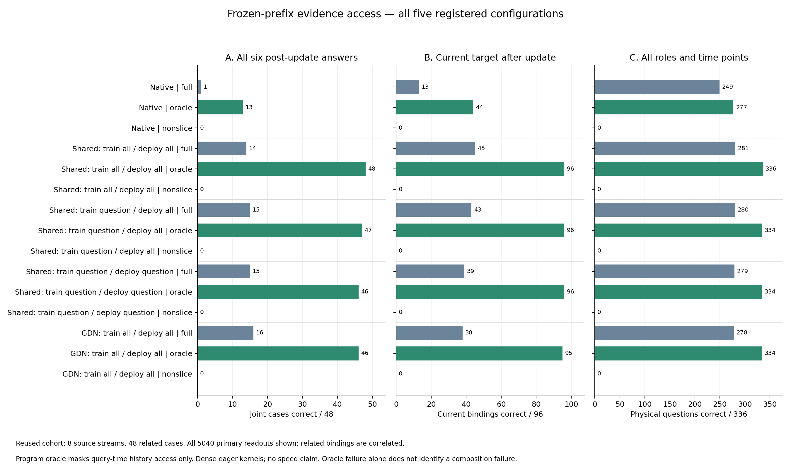

# 冻结历史状态的证据访问：完整诊断结果

**5040次正式读出及独立审计完成。** 固定5个既有配置、3种访问条件，保留全部48个关联案例、336个物理问题、432个关联绑定；没有训练、检查点选择或新环境。

这次复用63000–63007的8个来源事件流，是解释性诊断。48个深度/表述变体及432个绑定相互关联，不能当作独立重复；不是新的未见队列确认。全部旧研究门槛仍失败，本轮没有架构成功阈值。

full使用完整历史；oracle只允许问题/回答Attention访问程序真值推导的支持事件；nonslice使用与支持列不重叠、历史Token数完全相同的控制列。所有条件保留原始Token和位置、正常历史GDN更新、完整递归历史以及问题阶段新列。

## 全部配置与条件

联合指标要求两种更新顺序下的当前值、历史值、无关值共6个回答全部正确。角色列为更新后关联绑定，物理问题列已去重。

| 配置 | 条件 | 联合 /48 | 当前 /96 | 历史 /96 | 无关 /96 | 物理问题 /336 |
|---|---|---:|---:|---:|---:|---:|
| Native | full | 1 | 13 | 96 | 92 | 249 |
| Native | oracle | 13 | 44 | 96 | 89 | 277 |
| Native | nonslice | 0 | 0 | 0 | 0 | 0 |
| Shared：训练all / 部署all | full | 14 | 45 | 92 | 96 | 281 |
| Shared：训练all / 部署all | oracle | 48 | 96 | 96 | 96 | 336 |
| Shared：训练all / 部署all | nonslice | 0 | 0 | 0 | 0 | 0 |
| Shared：训练question / 部署all | full | 15 | 43 | 93 | 96 | 280 |
| Shared：训练question / 部署all | oracle | 47 | 96 | 96 | 95 | 334 |
| Shared：训练question / 部署all | nonslice | 0 | 0 | 0 | 0 | 0 |
| Shared：训练question / 部署question | full | 15 | 39 | 96 | 96 | 279 |
| Shared：训练question / 部署question | oracle | 46 | 96 | 96 | 94 | 334 |
| Shared：训练question / 部署question | nonslice | 0 | 0 | 0 | 0 | 0 |
| GDN：训练all / 部署all | full | 16 | 38 | 96 | 96 | 278 |
| GDN：训练all / 部署all | oracle | 46 | 95 | 96 | 95 | 334 |
| GDN：训练all / 部署all | nonslice | 0 | 0 | 0 | 0 | 0 |

## 完整深度分解

| 配置 | 条件 | 深度1 /16 | 深度2 /16 | 深度3 /16 |
|---|---|---:|---:|---:|
| Native | full | 1 | 0 | 0 |
| Native | oracle | 6 | 4 | 3 |
| Native | nonslice | 0 | 0 | 0 |
| Shared：训练all / 部署all | full | 12 | 2 | 0 |
| Shared：训练all / 部署all | oracle | 16 | 16 | 16 |
| Shared：训练all / 部署all | nonslice | 0 | 0 | 0 |
| Shared：训练question / 部署all | full | 13 | 1 | 1 |
| Shared：训练question / 部署all | oracle | 16 | 15 | 16 |
| Shared：训练question / 部署all | nonslice | 0 | 0 | 0 |
| Shared：训练question / 部署question | full | 15 | 0 | 0 |
| Shared：训练question / 部署question | oracle | 16 | 15 | 15 |
| Shared：训练question / 部署question | nonslice | 0 | 0 | 0 |
| GDN：训练all / 部署all | full | 15 | 0 | 1 |
| GDN：训练all / 部署all | oracle | 16 | 15 | 15 |
| GDN：训练all / 部署all | nonslice | 0 | 0 | 0 |

## Oracle配对收益与退化

每一行都比较同模型、同问题；“修复/退化”按oracle相对参照条件计算。物理计数覆盖全部336题。NLL差为oracle减参照，负值表示金标损失更低。

| 配置 | 参照 | 当前改善 /退化（96） | 联合改善 /退化（48） | 物理修复 /退化（336） | 当前平均NLL差 |
|---|---|---:|---:|---:|---:|
| Native | full | 32 / 1 | 12 / 0 | 35 / 7 | -0.403485907 |
| Native | nonslice | 44 / 0 | 13 / 0 | 277 / 0 | -2.22543932 |
| Shared：训练all / 部署all | full | 51 / 0 | 34 / 0 | 55 / 0 | -0.76207827 |
| Shared：训练all / 部署all | nonslice | 96 / 0 | 48 / 0 | 336 / 0 | -4.03277775 |
| Shared：训练question / 部署all | full | 53 / 0 | 32 / 0 | 56 / 2 | -0.582032431 |
| Shared：训练question / 部署all | nonslice | 96 / 0 | 47 / 0 | 334 / 0 | -3.78081305 |
| Shared：训练question / 部署question | full | 57 / 0 | 31 / 0 | 57 / 2 | -0.648156692 |
| Shared：训练question / 部署question | nonslice | 96 / 0 | 46 / 0 | 334 / 0 | -3.56085361 |
| GDN：训练all / 部署all | full | 57 / 0 | 30 / 0 | 57 / 1 | -0.780278754 |
| GDN：训练all / 部署all | nonslice | 95 / 0 | 46 / 0 | 334 / 0 | -3.503144 |

## 本轮观察

原Shared/all在Oracle条件下从14/48升到48/48，三个深度均为16/16，336个物理问题全部正确，55个修复、0个退化。在固定的question训练/question部署配置中，历史状态与Native一致，当前目标却能达到96/96、联合46/48；相对full有57个当前目标改善、0个变差，但全部角色合计仍有2个物理问题退化。GDN/all也达到46/48，不能忽略这个强基线。

因此，在这些既有适配器与本任务族中，改变问题阶段的证据访问/干扰抑制即可修复大量多跳错误，不需要先改变历史写入。它不支持直接把此前full失败主要归因于“GDN写坏了记忆”，也不证明共享控制器优于GDN-only或新的语义依赖架构有效。Native加Oracle仍只有13/48，说明Oracle访问本身不是所有配置都能充分利用的答案通道。

nonslice在五个配置中均为0/336，所有角色都大幅退化。它虽然严格匹配历史Token数，但会破坏完整事件语法、移除关键值，属于很强的干预；不能把Oracle相对该条件的巨大差异当成独立、干净的地址机制证据。需要同时重视Oracle相对完整历史的改善与退化。

## 解释边界与下一步

Oracle改善可以支持问题阶段的历史访问或干扰抑制对结果有作用；不能唯一归因于GDN状态受损、语义作用域或某种检索机制。正确证据掩码无效时，KV表示、问题阶段计算、注意力分配和干预分布偏移仍可能造成失败，不能直接断言模型不会组合关系。

nonslice匹配Token预算，不保证完整事件语法。这里使用dense eager Attention加掩码，不是高效稀疏Kernel，也没有延迟收益或新Router有效性的结论。后续归因若涉及关系组合能力，必须单独登记文本证据与已执行状态等能力控制；本轮没有执行该控制。

所有角色、深度、表述、更新量及来源流的逐问题修复/退化和NLL差保存在完整JSON/CSV。通用配对工具中的candidate_passed是继承的描述字段，不是本诊断的新成功门槛，不能改变旧判定。

## 审计与复现材料

两组相反顺序的270次安全运行严格一致，并在正式推理前完成独立审计。正式运行的1680次完整历史重放逐项匹配既有记录的五项字段。封存并核验166份运行源码；50组主要控制加10组深度2控制共核验120次实际掩码Attention及完整历史保留。question部署配置对全部56个历史前缀核验native状态、KV、卷积缓存、簿记及logits的一致性。主干和适配器权重未变，钩子恢复。

- [完整独立审计](trained-timing-evidence-access-audit-20261115-01.json)
- [全部5040条原始答案与损失 CSV](trained-timing-evidence-access-figure-20261115-02.csv)
- [全部960条当前目标配对NLL CSV](trained-timing-evidence-access-figure-20261115-02.pairs.csv)
- [全部指标、分层与逐问题比较](trained-timing-evidence-access-figure-20261115-02.data.json)
- [独立计数与CSV逐条核对](trained-timing-evidence-access-figure-20261115-02.crosscheck.json)
- [PDF图表](trained-timing-evidence-access-figure-20261115-02.pdf)
- [推理前登记与覆盖修正说明](pre-inference-notes.md)
- [正反顺序等价性审计](trained-timing-evidence-access-smoke-equivalence-20261115-01.json)
- [原训练检查点快照](https://github.com/HUSRCF/HML-Hybrid-Memory-Lab/releases/tag/matched-shared-training-timing-2026-11-15)

本页由已审计的全部原始结果生成；完整归档与远端发布核验回执在完成后另行加入。

补充控制后的完整测试215项通过。2700×1620图表已目视检查；02版将图题改为“五个登记配置”，因为其中两项使用同一检查点，避免误称五个不同检查点。01版完整保留，两版统计和CSV一致。

## 完整增量归档

本地归档逐项解压字节核验通过：1332个材料文件、1333个条目，11,942,597字节，SHA-256 `70f8690b59d8228a05f63136f6311a74c890c52c9497696d6a750af7437d0fdd`。

归档包含本轮15份完整原始结果、两组安全运行、336份掩码登记与原始队列、166份封存运行源码、全量CSV/指标/图表、旧16配置原始参考和固定审计。排除主干权重、环境、缓存及已经发布的训练检查点。归档的运行日志和进度记录保留其快照时点；打包与远端发布的最终回执另存，避免自引用。

- [文件与SHA-256清单](file_manifest.json)
- [本地逐项验证回执](local_verification.json)
- [本轮原始材料Release](https://github.com/HUSRCF/HML-Hybrid-Memory-Lab/releases/tag/trained-timing-evidence-access-2026-11-15)
