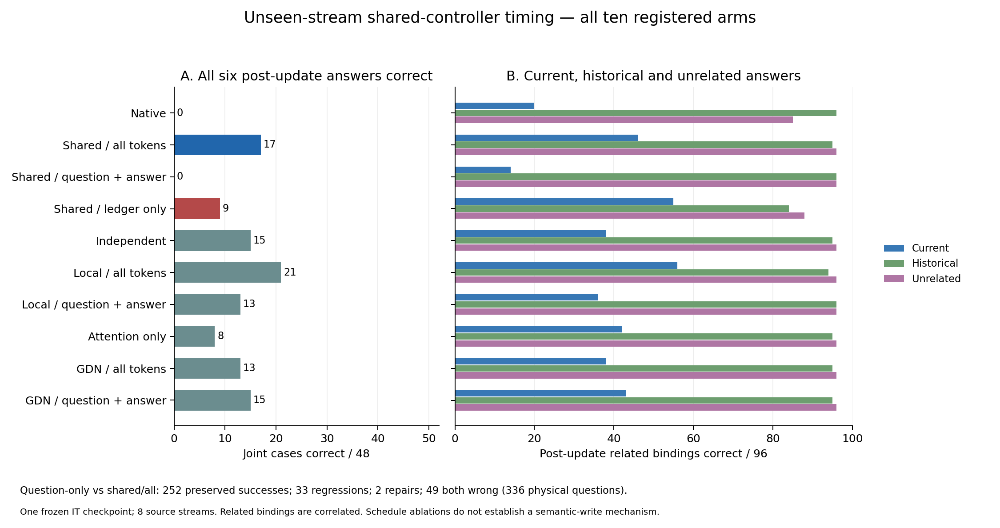

# 冻结共享控制器的启用时段：未见事件流验证

**3,360 次完整回答已完成并通过独立审计，两项预登记判据均失败。**同一共享检查点仅在问题及答案阶段启用时，联合正确案例从 17/48 降为 0/48，损失 33 个原先答对的问题、修复两个；普通局部适配器达到 21/48，高于全时段共享控制器。

| 配置 | 联合正确 /48 | 当前值 /96 | 历史值 /96 | 无关事实 /96 |
| --- | ---: | ---: | ---: | ---: |
| 原模型 | 0 | 20 | 96 | 85 |
| 共享／全时段 | 17 | 46 | 95 | 96 |
| 同一共享／仅问题及答案 | 0 | 14 | 96 | 96 |
| 同一共享／仅事实前缀 | 9 | 55 | 84 | 88 |
| 独立控制器 | 15 | 38 | 95 | 96 |
| 局部适配／全时段 | 21 | 56 | 94 | 96 |
| 局部适配／仅问题及答案 | 13 | 36 | 96 | 96 |
| 仅 Attention | 8 | 42 | 95 | 96 |
| 仅 GDN／全时段 | 13 | 38 | 95 | 96 |
| 仅 GDN／仅问题及答案 | 15 | 43 | 95 | 96 |

联合指标要求一个案例在两种事件顺序下的当前、历史、无关事实六个答案全部正确。后三列是更新后的相关绑定计数，不能当作 96 个独立样本。

[完整审计](unseen-shared-timing-audit-20261115-01.json) · [全部 3,360 行回答与损失](unseen-shared-timing-comparison-20261115-01.csv) · [PDF](unseen-shared-timing-comparison-20261115-01.pdf) · [完整分层指标](unseen-shared-timing-comparison-20261115-01.data.json)

仅问题阶段保留了共享模型的 252 个成功，33 次退步全部属于当前值查询；另外有两个修复、49 个两者均失败的问题。相对原模型的联合正确率净收益为零，总体、每一档深度及事件流覆盖条件均未通过。仅前缀阶段虽然当前值更好，却同时降低历史值与无关事实表现，不能只选当前值一列宣称改进。

在这批数据上，结果排除了“现有共享检查点只需部署到问题阶段即可保留收益”的具体假设。它没有排除专门训练的问题阶段模型：既有仅问题阶段训练的局部和 GDN 基线仍分别达到 13/48、15/48。全时段训练模型的时段切换存在部署分布变化，不能单独证明前缀语义写入必要或原生递归记忆损坏。共享设计也尚未超过普通局部适配器；进一步方法必须保留这个强对照。

独立审计核对了 17,472 次实际前向记录、100 次挂载前原模型重放、100 次卸载后重放、90 次挂载但禁用控制器的恒等检查，以及 68 次完整原生前缀检查，其中共享仅问题配置覆盖全部 56 个不同前缀。全部 136 份成功运行源码保持封存；此前三项失败的未见数据判据也保持原结论。

后续训练需先另行登记方法、匹配预算及训练时段对照，区分部署分布变化与前缀处理的实际作用。本轮结果不会自动触发新训练或扩大模型。

研究问题：同一个已训练的共享控制器，是否必须在事实前缀上启用，才能保留它的回答收益？本轮没有新增训练，也未实现显式语义依赖控制器。

固定方案见 [实验登记](../../../configs/unseen_shared_timing_plan.json)。唯一批次使用种子 62000–62007，包含 48 个相关案例、336 个不重复问题和 432 条相关绑定，覆盖三档依赖深度、两种问题措辞及 8/64 次干扰更新。与此前 18 个已登记数据目录独立核对后，没有种子、编号、完整提示或完整前缀重叠。

保留八种原有基线，并为同一个共享检查点增加“仅问题及答案阶段”和“仅事实前缀阶段”两种启用时段。正式评估固定为十组、3,360 次完整回答。所有组保留完整历史 Attention、原始答案评分和停止规则。

正式评估前必须通过两轮各 180 次回答的正反顺序运行检查，以及逐条严格等价审计。完整项目的 193 项回归测试已经通过；第一次测试暴露的历史目录清单问题及原始失败日志也保留。修正仅涉及未封存测试，旧实验运行源码保持不变。

“仅问题阶段”必须在全部 56 个不重复事实前缀上保留原模型的完整 KV、递归状态、卷积状态、缓存属性和最后位置 logits。运行器还观察每次原生投影，检查适配器没有修改启用区间以外的位置。

主要判断分别报告：

- 问题阶段启用后，原共享模型答对的问题是否出现任何退步，以及全部修复与保留；
- 相对原模型的联合正确率净收益，是否同时在总体、各依赖深度及至少三条事件流上为正；
- 前缀阶段启用的对照表现，以及全部八种原有基线的当前值、历史值和无关事实结果。

相关绑定与不同深度的案例不作为独立统计样本。启用时段变化会改变全时段训练模型的部署分布，因此退步不能单独证明语义写入必要，更不能据此宣称新的混合架构有效。此前首批未见数据上的三项失败判据保持原结论。

原始备份仍固定在 [research-backup-2026-11-15](https://github.com/HUSRCF/HML-Hybrid-Memory-Lab/releases/tag/research-backup-2026-11-15)。本目录记录恢复工作后的独立里程碑；运行状态以 [进度记录](../../../configs/experiment_progress.json) 为准。

本轮完整原始记录见增量快照 [unseen-shared-timing-2026-11-15](https://github.com/HUSRCF/HML-Hybrid-Memory-Lab/releases/tag/unseen-shared-timing-2026-11-15)。归档共 618 个文件、3,757,341 字节，每个成员均经过 SHA-256 校验；[逐文件清单](raw-archive-file-manifest.json) 和 [归档校验值](raw-archive.json) 随材料保存。恢复时先使用原始备份，再将本增量解压至存储根目录。
