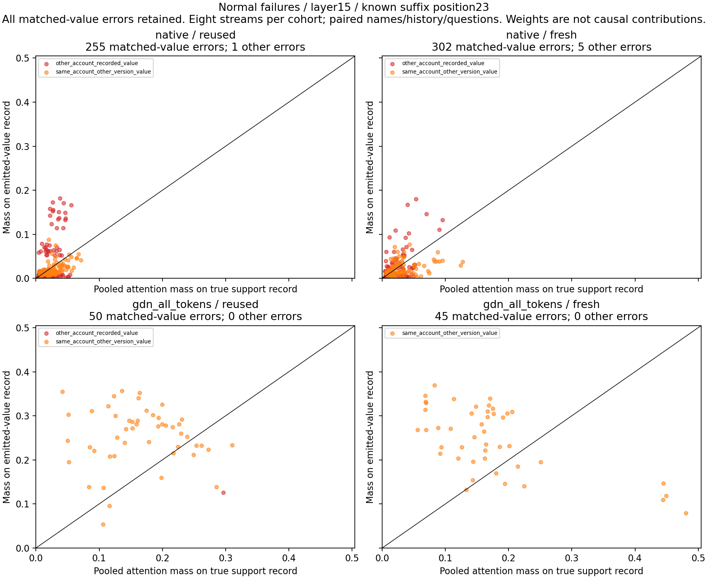
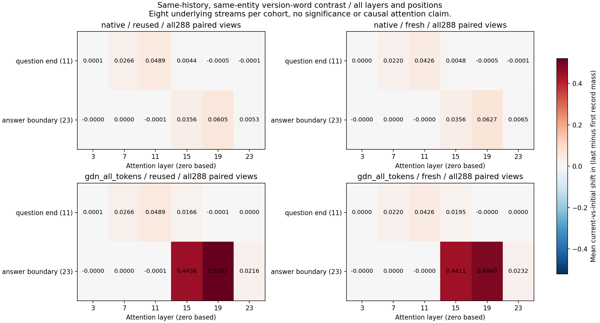

# 正常历史上的实体与版本读取观测

全部 3,456 次正常读出已完成并通过独立审计。旧队列的 1,728 次回答和原有被动检查精确重放；八条预先固定的新事件流中，既有 GDN 适配器答对 819/864，45 个错误全部输出同一账户的其他版本值，保护账户 288/288。未新增训练、参数、环境或模型；主干为本机 Qwen3.5-2B IT，不是 Base。

这复现了版本混淆这一行为缺陷，没有建立 Shared 四层联合控制器的优势，也没有证明递归状态遗忘、容量不足或某组三个 GDN 的唯一作用。全部旧失败判据保持 false。

## 完整准确率

每种问法 432 个问题；最后一列要求同一历史的两种问法、三个角色共六个回答全部正确，分母 144。

| 模型 | 队列 | current/initial /432 | last/first /432 | 同一缓存六问全对 /144 |
|---|---|---:|---:|---:|
| native | reused | 316 | 292 | 34 |
| native | fresh | 286 | 271 | 21 |
| gdn_all_tokens | reused | 412 | 402 | 111 |
| gdn_all_tokens | fresh | 410 | 409 | 118 |

GDN 适配器全部角色如下，每格分母 144。原模型的全部角色和所有条件也保留在导出表中。

| 队列 | 问法 | 当前值 | 初始值 | 保护账户 |
|---|---|---:|---:|---:|
| reused | state_term | 137 | 131 | 144 |
| reused | event_term | 125 | 134 | 143 |
| fresh | state_term | 136 | 130 | 144 |
| fresh | event_term | 135 | 130 | 144 |

新队列的 45 个 GDN 错误分布在全部八条基础事件流；19 对问题在两种问法下都错，且输出相同的错误值。由 current/initial 改为 last/first 带来 3 次修复、4 次退步，不能作为普遍修复策略。旧队列仍为 50 错，其中 49 个同账户其他版本、1 个其他账户；17 对两种问法下稳定错误全部保留。

## 固定观测位置与反例

主观测位置在协议中固定为零起始 Attention 第 15 层、已知后缀第 23 个位置。以下仅统计回答错误且输出数值能对应历史记录的读出；未对应历史数值的错误也完整保留并计数。权重为全部八个 Query 头平均后，对原始 14 Token 记录求和。

| 模型 | 队列 | 全部错误 | 能对应记录 | 错误值记录权重更高 | 正确支持记录权重更高 |
|---|---|---:|---:|---:|---:|
| native | reused | 256 | 255 | 88 | 167 |
| native | fresh | 307 | 302 | 84 | 218 |
| gdn_all_tokens | reused | 50 | 50 | 39 | 11 |
| gdn_all_tokens | fresh | 45 | 45 | 35 | 10 |

新队列的 10 个 GDN 反例中，正确支持记录仍是该固定位置的最高记录权重。头平均可能隐藏头内分工，记录权重也不等于对答案的因果贡献。因此，不能把全部版本错误解释成“正确证据没被注意到”，也不能由权重较低推断信息已从 GDN 中消失。

为了不只挑第 15 层，下表保留全部六层和两个登记位置；数字为“错误输出对应记录权重高于正确支持记录”的次数，旧队列分母 50、新队列分母 45。

| Attention 层 | 问题末 11：旧 /50 | 问题末 11：新 /45 | 答案前缀末 23：旧 /50 | 答案前缀末 23：新 /45 |
|---|---:|---:|---:|---:|
| 3 | 27 | 17 | 38 | 38 |
| 7 | 13 | 19 | 42 | 38 |
| 11 | 24 | 29 | 27 | 36 |
| 15 | 23 | 26 | 39 | 35 |
| 19 | 27 | 33 | 43 | 36 |
| 23 | 25 | 29 | 25 | 32 |

## 同历史、同实体的版本问词对照

current 与 initial、last 与 first 的每对目标问题共享同一历史和同一实体，只改变已知后缀第 5 个 Token。对每个问题计算“最后一次减第一次写入记录的权重”，再计算当前问法减历史问法的差。每个模型/队列的均值包含全部 288 个配对视图，全部六层和两个位置均保留。

新队列在答案前缀末，第 15 层的平均版本偏好差为原模型 0.0356、既有 GDN 适配器 0.4411；第 19 层为 0.0627、0.4840。模式在两个队列相似，第 19 层也有强信号，不能据此把第 15 层或前面三层认定为唯一机制位置。两种模型的历史计算和多个下游表示都可能不同，这里没有分离 Query 与 K/V 的作用。

## 执行、范围与复现

- 协议先于代码、数据和推理提交：`4c9a046`；268 个测量源文件和完整输入在 `498cf6f` 封存并推送后才启动原生检查。352 项 CPU 回归在封存前全部通过，耗时 407.200 秒。归档脚本不属于可变更测量路径。
- 旧队列固定 76000–76007，新队列在协议中固定 82000–82007；各有八条基础流、两种重命名、九种正常历史条件、两种问法和三个角色。新输入与协议钉住的 28 个旧输入包核对，未替换种子或筛选结果。Fresh 指新的合成事件流，不是新任务、新操作或真实分布。
- 正常构建 64 份前缀缓存及 512 份后续缓存；同一模型与条件下，所有问题共享该正常历史的隔离副本。完整历史最长 7,519 Token。没有 Oracle 读取、供体前向、门控冻结或额外训练。
- 只观测第一次处理的 24 个已知问题/格式 Token。观测接口不接受角色、答案或支持标签；所有自己的观测 hook 在答案计分和自由生成前移除。生成结束后才关联程序真值。
- 相反模型顺序两轮各 216 次读出，两个模型的原始回答、旧参考和 36 份 FP32 文件精确一致；主实验共享子集也精确重放。没有准确率筛选门槛。
- 主审计重新聚合全部 576 份原始 FP32 数组、41,472 行分层观测，并核对 96 次既有运行控制。独立判分脚本从原始 SET 事件再次核对全部 3,456 个回答。全部原有失败判据维持 false。
- 每个队列只有八条基础事件流；账户重命名、历史条件、问题及模型并非独立样本。这里不作显著性、跨任务、100K 长度或多跳 COPY 成功的声明。

完整导出：[全部回答](exports/primary.csv)、[全部分层观测](exports/pooled-record-observations.csv)、[全部正确性分组（含空组）](exports/all-correctness-strata-including-empty.csv)、[所有配对](exports/same-history-version-pairs.csv)、[原始数组清单](exports/raw-fp32-array-inventory.csv)。全部 576 份正式原始数组、72 份执行检查数组及原始运行元数据将进入完整增量备份。

本机命令：先 `bash scripts/run_version_address_pipeline.sh`，完成审计后 `bash scripts/run_version_address_postprocess.sh`。两者都拒绝覆盖已有输出；复现时需显式使用新的输出位置。封存的输入与原始结果不应被改写。

## 当前判断与下一步

版本错误在新合成流上复现，而且存在正常状态下可供继续诊断的具体失败。但这是已有 GDN 适配器的泛化与观测证据，不是新架构成绩。后续应检验可学习的证据使用能否超过这个强基线，同时区分问词理解、头内读取与后续计算；任何联合 Block 方法仍须超过同数据、同参数预算的独立/局部或单路径适配。不能仅由这些头平均图决定新结构，也不能忽略正确支持权重已较高的反例。

主审计 manifest SHA-256：`798b044b2deb77c7b2e384f9d892fcfa3481e7266cf10f8e8fbc9f037be6e102`。数据包 SHA-256：`138f248163f886c6ef95521f26ae14f46ebae56a7df06cfb97195ad69d6c16f8`。封存收据 SHA-256：`b9f517bd5b88c6dffaf76a7ea612288cfe29e9ff34d133b61369201d28aeb5e2`。

备份状态：本地完整归档与远端附件逐字节核验待完成；总体研究目标保持 active。
