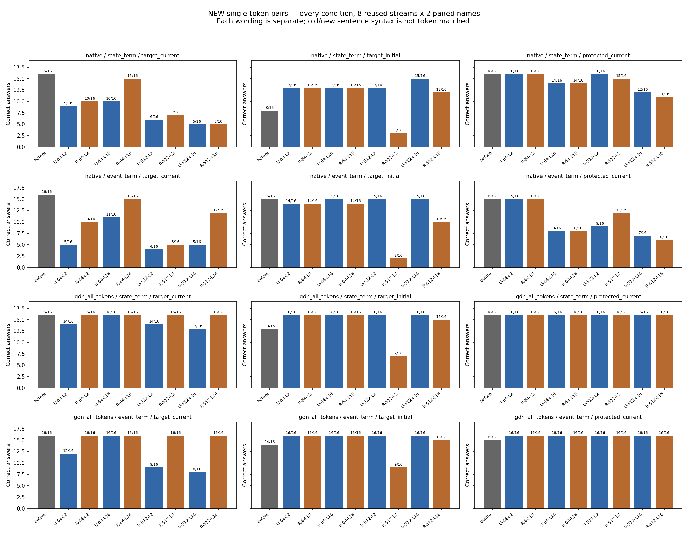

# 单 Token 版本问法对照：完整结果

**本轮已完整审计。简单换词没有消除版本错误。** 两个模型完成 1,728 次新 Full 读出，另保留全部 1,728 条明确标注的旧 Full 参考。没有新训练、Oracle、供体前向、模型下载或环境。旧三项失败判据均保持 false。

| 模型 | `current/initial` | `last/first` | 换词修复 | 换词退步 |
|---|---:|---:|---:|---:|
| 原模型 | 316/432 | 292/432 | 30 | 54 |
| 已有冻结 GDN 适配器 | 412/432 | 402/432 | 3 | 13 |

统一问题是 `What is the {term} balance assigned to account {entity}?`。每个问题 24 Token；全部 432 对都仅第六个 Token 不同，问题以外的历史、其余 Token 位置、答案和支持记录相同。新比较跨两个模型共 864 对；每个模型 432 对。复用八条基础事件流、两种命名、144 个正常历史条件，最长 7,519 Token。命名和历史条件是重复测量，不能当作新的独立事件流。

| GDN 问题角色 | 状态词正确 /144 | 事件词正确 /144 | 修复 | 退步 |
|---|---:|---:|---:|---:|
| 目标当前值：current → last | 137 | 125 | 0 | 12 |
| 目标初始值：initial → first | 131 | 134 | 3 | 0 |
| 保护账户：current → last | 144 | 143 | 0 | 1 |

`first` 只修复了状态词条件 20 个 GDN 错误中的 3 个，同时 `last` 引入 13 个新错误。两种新问法的 50 条错误回答中，49 条等于被查询账户的另一版本值，1 条等于其他账户的前缀值。状态词的 20 条错误全是同账户其他版本值。数值匹配是输出归类，不证明模型内部实际读取了那条记录。

17 个配对问题在两种新问法下都失败，并输出完全相同的错误值：7 个当前值、10 个初始值，覆盖七条基础流。它们全部属于同账户其他版本值。这个子集是审计后的描述性观察；完整 864 对仍保留，不能把该子集当成新预登记测试集或独立的 17 条事件流。另有 11 个问题在两种旧句式和两种新句式下都失败，覆盖六条基础流；旧、新句式比较不满足等长单 Token 控制。

同一缓存上三种角色同时正确，GDN 状态词为 124/144，事件词为 114/144；三种角色 × 两种新问法的六个回答同时正确为 111/144。原模型对应为 52/144、51/144、34/144。这里没有训练新结构，也没有建立 Shared 相对 Independent、Local 或已有 GDN 强基线的优势。

以下完整列出新实验的全部 36 个模型／问法／历史条件。每格依次为当前值／初始值／保护账户正确数，三个分母各为 16。U 是无关更新，R 是相关更新，L 是活跃更新账户数；64/512 是后续记录数。

| 条件 | 原模型状态词 | 原模型事件词 | GDN 状态词 | GDN 事件词 |
|---|---|---|---|---|
| before | 16/8/16 | 16/15/15 | 16/13/16 | 16/14/15 |
| unrelated-64-load2 | 9/13/16 | 5/14/15 | 14/16/16 | 12/16/16 |
| related-64-load2 | 10/13/16 | 10/14/15 | 16/16/16 | 16/16/16 |
| unrelated-64-load16 | 10/13/14 | 11/15/8 | 16/16/16 | 16/16/16 |
| related-64-load16 | 15/13/14 | 15/14/8 | 16/16/16 | 16/16/16 |
| unrelated-512-load2 | 6/13/16 | 4/15/9 | 14/16/16 | 9/16/16 |
| related-512-load2 | 7/3/15 | 5/2/12 | 16/7/16 | 16/9/16 |
| unrelated-512-load16 | 5/15/12 | 5/15/7 | 13/16/16 | 8/16/16 |
| related-512-load16 | 5/12/11 | 12/10/6 | 16/15/16 | 16/15/16 |

[全部新旧条件、NLL 与分层 CSV](exports/report.md)；[全部 1,728 次新回答](exports/primary.csv)；[全部旧参考](exports/archived-references.csv)；[864 个配对修复与退步](exports/state-to-event-pairs.csv)；[每条回答的数值归类](exports/value-attribution.csv)。新旧图分别保留，均已目视检查。

旧参考中，GDN original=408/432、entity_first=413/432；原模型分别为 295/432、220/432。旧问法与新句式不等长，以上仅作明确标注的历史参考，不能把新旧差异解释为纯单词效应。

所有 32 份正常前缀和 256 份正常尾部缓存的 48 个字段、logits、布局、元数据及证明都精确匹配前轮；主实验与执行检查重合的 108 次读出、两份前缀及 16 份尾部精确重放。两个相反模型顺序的检查也精确一致。完整 331 项 CPU 回归通过；246 个原文件、4 个独立序列化校验修正文件、4 个纯 CPU 终端验证恢复文件分别封存，共 254 来源。

原生流水线曾有两次完整性校验失败：首次完成 native 54 次读出后，运行内整数层号与 JSON 字符串层号比较误报；独立修正后完成全部 1,728 次读出，但最终重叠子集比较又遇到同类问题。两个原失败目录、全部结果和日志均保留。第二次通过登记并封存的纯 CPU 验证恢复，新建逐字节副本；只补全终端校验字段和来源，原错误字段继续保留，再交给原 250 来源审计器完成全部科学与运行检查。没有重复模型推理、数值修改或放宽容差；审计完成不等于原流水线无异常。

辅助描述性收据第一版的旧问法 ID 映射重复了 original ID；第二版改为按 context/role/style 显式查表，所有新评分、864 配对、稳定失败和联合正确数均逐项确认不变。两版收据一起备份；这不改动任何封存实验来源或正式结果。

下一轮已在新代码、数据与推理前登记 `configs/question_state_freeze_plan.json`。保持正常历史缓存，仅在 24 个已知问题后缀 Token 上冻结选定 GDN 组的递归矩阵更新，答案阶段恢复原计算；第 12/13/14 层与其余五组三层 GDN 等量比较，另有 all18 广泛对照。完整保留两种问法与全部角色，共计划 6,912 次读出，不筛选 17 个失败、不用 Oracle 或供体前向、不训练新参数。新一轮尚未开始代码、数据包或推理；它先检查问题阶段的更新，再指导是否进一步拆分实体与版本证据使用。当前结果支持保留版本区分问题，但尚未证明某个四层组是独有故障源，也没有证明改写记忆更新优于改善问题处理或证据使用。方法仍需在无 Oracle、无额外供体前向的正常运行下，改善版本查询和多跳任务，并超过简单适配与既有强基线。

完整[增量 Release](https://github.com/HUSRCF/HML-Hybrid-Memory-Lab/releases/tag/version-question-control-2026-11-15)已发布，固定快照提交为 `bea85753f03f425124c7309333e13ca72667d087`。压缩包包含 1,918 个文件，21,906,709 字节，SHA-256 `dd73d4af938ce4aabce4fc69d1fc458092c02fe844fdb7c5458df130f3942cb7`。三个远端附件都经实际下载逐字节核对；318 份代码／材料快照与提交逐字节匹配。发布后收据保存在本目录，原始失败、验证副本和全部材料一并保存。

---

以下保留按时间追加的登记、失败与恢复记录。

# 单 Token 版本问法对照

前轮正常更新诊断已[完整发布](https://github.com/HUSRCF/HML-Hybrid-Memory-Lab/releases/tag/natural-update-load-2026-11-15)：既有 GDN Full 821/864，43 个错误中 40 个输出同账户另一版本的值。保护账户为 288/288；更多活跃账户有时反而改善历史查询。因此，本轮先检查版本指代的问法，而不是马上增加更新模块。

协议 `configs/version_query_control_plan.json` 在新代码、数据和推理之前登记，SHA-256 `34d0ae71adf9507bb345bcc1c051bf09e33278d26e4706f4a919a3c3b9a56807`。复用全部八条基础流、两种账户命名和 144 个历史条件，不挑先前失败的样本。模型、原生 BF16 路径和冻结适配器的 FP64 累积后舍入 FP32 路径均保持原有设置；没有新训练或环境。

统一句式是 `What is the {term} balance assigned to account {entity}?`。目标初始值比较 `initial` 与 `first`，目标及保护账户当前值比较 `current` 与 `last`。Tokenizer 检查确认全部 864 个问题组成 432 对：每个问题都是 24 Token，每对只有第六个问题 Token 不同，完整历史与其余 Token 位置相同，答案及支持记录不变。检查期间没有模型构造、权重加载或 GPU 初始化。

两个问题读同一个正常历史缓存的独立副本。完整设计为 1,728 次新 Full 读出，另保留全部 1,728 次旧 Full 参考并明确标为历史数据。新主比较只有 `state_term → event_term`；旧问法与新句式不等长，不能当作纯单 Token 对照。新结果每个模型／问法／历史条件／问题角色的分母为 16，不是将两种处理合并后的 32。独立基础流仍然只有八条。

本轮复用上一轮模型函数的原代码对象，为副本单独绑定 Full Reader 与问题枚举；原模块全局绑定保持不变。全部新历史缓存的 48 个字段、logits、布局、元数据及尾部证明都需逐项匹配上一轮，只有预登记问题数带来的检查次数不同。主实验还需精确重放与执行检查重合的 108 次读出。

两个相反模型顺序的执行检查各覆盖第一条流、原命名、全部九种历史条件与两种新问法，共 108 次新读出。独立审计、四份原始新／历史文件及全部模型缓存状态精确一致后，才允许启动主实验。原先 240 个文件保持不变，加六个新文件封存为 246。11 项新 CPU 测试已经通过，包括完整双模型审计、缺行／缓存／旧错误修改拒绝、原函数全局不变以及异常时清理适配器与运算钩子。

这只检验等长的问法敏感性。即使更换一个词能改变回答，也不能直接认定它对应某个内部地址，或证明需要改写 GDN；问题处理本身会经过递归层和 Attention。所有先前失败判据保持原判，不增加新显著性、架构有效性或规模扩展门槛。完整回归测试、封存和模型执行状态随后记录。

用户复核 `07d0197` 后，本阶段继续遵循以下研究范围：训练／部署时段的三乘三对照已经完成，不再重复；Shared 相对强基线的稳定优势尚未建立；正常 SET 任务的 95% 不能视为 COPY 多跳任务已经解决。若后续需要状态干预，应分开比较适配器所在组三个 GDN 与其他 GDN，不能把全部 18 个状态回退的效应都归给该组。

最终方法仍需在正常构建的同一份缓存、没有 Oracle 或额外供体前向的条件下，稳定减少版本错误、改善多跳表现，并超过简单适配与现有 GDN 强基线。当前单词对照是排除问法混淆的步骤，不替代这一更完整的研究目标，也不修改旧预登记判据。

全套 319 项测试通过（247.831 秒），246 个源文件现已封存。独立重建确认全部 864 个问题、432 对单 Token 控制以及 1,728 个旧参考；无模型构造、权重加载或 GPU 初始化。数据包 manifest SHA-256 为 `d3297596bcefc879bcbea7c9c3458e6d019c30a43a7f5aa654217d84b16e8a3d`。本条记录于模型执行前，GPU 检查尚未启动。

第一轮原生模型执行完成 54 次读出后，前驱缓存比较失败，流程因此停止；没有启动 GDN 适配器或主实验。失败目录及日志保留，不将部分结果用于样本或门槛选择。只读检查确认八个尾部缓存的全部字段、logits 与序列化证明均一致。根因是 `tail_proof.gates.layers` 在运行内使用整数层号、历史 JSON 使用字符串层号，直接字典比较产生误报。CPU 重建该类型差异可复现原失败。

另行登记 `configs/version_query_serialization_correction.json`，保留全部 246 个已封存文件。新增四文件仅统一层号的 JSON 比较形式，并为后续运行记录与审计附加独立封存来源；不改变张量、浮点数、容差、问题、样本、权重或读出路径。新增六项 CPU 回归已通过，覆盖真实失败复现、非原地校验、数值与缓存篡改拒绝、完整双模型审计以及异常后的全局绑定恢复。完整回归正在执行；通过并封存后才允许使用新目录重新检查模型顺序及完整主实验。失败的部分读出仍随增量快照备份。

校验修正后的完整 325 项 CPU 测试通过（277.545 秒）；原 246 个文件与新增四文件已分别核验并封存。修正只影响证明层号的比较与溯源。新模型执行尚未开始；后续检查与主实验使用 `corrected-20261115-01` 新目录。

两个相反模型顺序的 108 次执行检查及全部原始文件精确一致。完整主实验的 1,728 次新读出也已全部执行，且两个模型的前驱缓存比较、权重和钩子恢复通过；但最终重叠子集校验再次因运行内整数层号与 JSON 字符串层号的比较而失败。第一处修正未覆盖这个第二入口，故原流水线退出码仍为 1，完整失败目录及其全部字节保留。

只读重载 JSON 后，原 `primary_subset_replay` 原代码无需修改即可验证全部 108 次重叠读出、两份前缀及 16 份尾部缓存精确一致；将层号还原为整数又可复现原误报。另行登记 `configs/version_query_terminal_validation_recovery.json`：不重跑模型，不改变任何原始结果；新建明确标为纯 CPU 校验恢复的副本，只补全终端验证字段及恢复来源，原错误字段继续保留。原 250 文件保持不变，新增四文件；六项恢复测试已通过，完整回归正在执行。正式恢复仍需封存后交由原 250 来源审计器完成所有检查，并额外核验失败原件、逐字节副本和恢复源码。

纯 CPU 恢复的完整 331 项测试通过（296.542 秒）；原 250 文件与新增四文件已分别核验、封存。正式 CPU 恢复与独立审计尚未启动；不会新增模型推理。

发布范围核验：首次公开附件调用在执行前被自动审批拒绝；只读核对确认仓库及前轮同类 Release 已公开，本包 1,882 个文件与现有公开 Git 对象完全相同，其余为已登记合成账本和运行元数据，无凭据模式命中。提交证据后，同一发布操作获复审放行；未绕过审批或改变公开范围。
